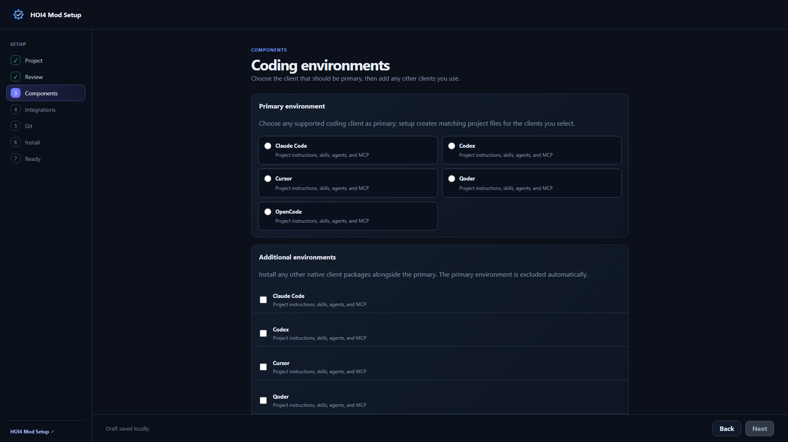
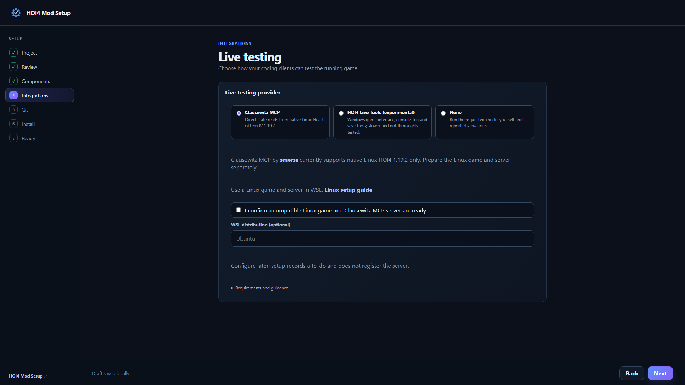

# Agentic HOI4 Modding

[](https://discord.gg/rAXesGcT2t)
[](https://www.youtube.com/@ChaosRedux)
[](https://ko-fi.com/klimpaskov)
[](https://github.com/klimPaskov/Agentic-HOI4-Modding/releases/latest)
[](https://klimpaskov.github.io/Agentic-HOI4-Modding/)
[](https://github.com/klimPaskov/Agentic-HOI4-Modding/issues)

<!-- TODO-VIDEO-LINK: replace with the HOI4 Mod Setup video URL -->
[](https://www.youtube.com/@ChaosRedux)

Build Hearts of Iron IV mods with your coding agent. Make focus trees, events, decisions and maps, fix broken script and balance the AI. The kit gives your agent project instructions, modding skills, specialist helpers, an offline wiki and HOI4 tools. Add portraits, 3D models, Super Events or live game testing when your mod needs them.

Choose any supported coding client, including Claude Code, Codex, Cursor, Qoder, OpenCode, GitHub Copilot (VS Code), Gemini CLI, Antigravity, Grok Build, Kilo Code, Kiro, Qwen Code, Cline, Devin Desktop, Augment, Continue, or Aider. HOI4 Mod Setup installs the project files and tools for the clients you select; Cline, Devin Desktop, Augment, and Continue keep MCP servers in their own settings, and Aider has no MCP support. The package keeps one canonical set of guidance and creates matching files for other clients.

[Download the complete package](https://github.com/klimPaskov/Agentic-HOI4-Modding/releases/latest/download/Agentic-HOI4-Modding.zip) | [Video tutorials](https://www.youtube.com/playlist?list=PLh6JmuEabQioc4V8IYGEsMtqiw-xemeX3)

## Get started

Use [HOI4 Mod Setup](https://github.com/klimPaskov/HOI4-Mod-Setup/releases/latest) to create a mod or prepare an existing one. The app selects and adapts the files for your mod, fills in your mod name, prefix, and game folder, connects HOI4 Agent Tools, and can update, repair or remove the setup later.

Open the mod in your coding client and describe what you want to build or fix. The agent picks the tools and skills it needs.

For a manual setup:

1. Put your mod in a Git repository and open that repository as the agent's workspace.
2. Copy [CLAUDE_template.md](CLAUDE_template.md) to your mod as `CLAUDE.md` and replace its placeholders (`[MOD_NAME]`, `[MOD_PREFIX]`, `[HOI4_GAME_DIR]`, `[STEAM_WORKSHOP_DIR]`). Delete the blocks for optional workflows you do not install.
3. Copy `.claude/skills/`, `.claude/agents/`, `.claude/settings.json`, `.mcp.json`, and `.tools/sync/` into the mod. Copy the source-packaging Python script, Windows launcher, and README from `.tools/` as well. Make the installed game files and the included `paradox_wiki/` snapshot readable to the agent.
4. If you also use another runtime, copy its generated folder (for example `.codex/`, `.cursor/`, `.qoder/`, `.opencode/`, `.gemini/`, `.kilo/`, `.kiro/`, `.qwen/`, `.devin/`, or `.augment/`) and its MCP file into the mod (plus root `opencode.json` for OpenCode), then generate its files from the Claude sources:

   ```powershell
   python .tools/sync/sync_instructions.py   # AGENTS.md
   python .tools/sync/sync_agents.py --runtime codex   # or cursor, qoder, opencode, gemini, antigravity, kilo, kiro, qwen, devin, augment
   python .tools/sync/sync_skills.py --target agents   # .agents/skills; or qoder, grok, kiro, qwen
   ```

5. Copy `.tools/mcp/` and `docs/runtimes.md` plus `docs/systems/hoi4_agent_tools_mcp_integration.md` into the mod. Install Python 3.13 and native x64 Node.js 22.19+ within major 22, or Node.js 24 LTS, with npm available on PATH. On Windows, `py -3.13` can replace `python` in these commands.
6. Install HOI4 Agent Tools with `python -I .tools/mcp/bootstrap_hoi4_agent_tools.py`, then approve the project server in your coding client and check that it connects. The bootstrap uses its own verified npm toolchain without replacing your existing npm executable or configuration.

   Native Linux users can follow the [Linux setup guide](docs/linux.md) for supported Node.js/Python prerequisites, the current-user install prefix and all client registration shapes. The package records separate Windows and Linux installed-tree evidence.

7. For live game testing, choose a provider and follow the [live-testing setup guide](.claude/skills/hoi4-live-playtest/references/setup.md). Clausewitz MCP needs manual Linux game/server setup and can connect directly on Linux; HOI4 Live Tools uses the Windows bootstrap. For portraits, 3D, or Super Events, copy the selected workflow's references, tools, and runtime assets together; use the [manifest](hoi4-mod-setup.manifest.json) as the file inventory. The setup app handles this selection automatically.

The templates are starting points. Keep only the workflows your mod uses and add project rules as the mod develops.

Package sources later with `python .tools/package_chatgpt_project_sources.py`
(or its Windows `.bat` launcher). See the [packaging tool guide](.tools/README.md#chatgpt-source-packaging)
for default file selections and output options.

## How the files fit together

| Canonical source | Purpose | Generated for other runtimes |
| --- | --- | --- |
| `CLAUDE.md` (`CLAUDE_template.md` here) | Project instructions | `AGENTS.md` |
| `.claude/skills/<name>/SKILL.md` | Reusable HOI4 workflows and their references | `.agents/skills/` (Codex, DSH, Gemini CLI, Antigravity, Kilo Code, Devin), `.qoder/skills/`, `.grok/skills/`, `.kiro/skills/`, `.qwen/skills/` |
| `.claude/agents/<name>.md` | Specialist roles and model tiers | `.codex/agents/*.toml`, `.cursor/agents/`, `.qoder/agents/`, `.opencode/agent/`, `.gemini/agents/`, `.agents/agents/`, `.kilo/agents/`, `.kiro/agents/`, `.qwen/agents/`, `.devin/agents/`, `.augment/agents/` |
| `.mcp.json`, `.claude/settings.json` | Claude Code MCP registration and settings | Each runtime's own MCP file |

Edit only the canonical files and rerun the synchronizers in [`.tools/sync/`](.tools/sync/README.md); add `--check` to find stale projections. [Runtime details](docs/runtimes.md) cover what each runtime reads.

## Specialist model tiers

Specialist roles use model tiers to match the work:

- **Opus**: improvement loop planner.
- **Sonnet**: 3D model pipeline, feature completion auditor, localisation auditor, scripted system architect, skill maintainer.
- **Haiku**: every other specialist (repo explorer, focus tree, decision, country package, and AI probability auditors, event UI worker, documentation curator, asset, icon, portrait, quote, and audio workers, spreadsheet worker, Super Events researchers).

The package maps each tier to settings supported by the selected coding client. See the [runtime reference](docs/runtimes.md) for details.

Other runtimes translate the tier through [`.tools/sync/agent_profiles.json`](.tools/sync/agent_profiles.json), for example into a Codex reasoning effort.

## Skills and agents

The [catalog](docs/catalog.md) covers building focus trees, events, decisions, country content, interfaces and assets, with links to each skill and specialist agent. HOI4 Mod Setup also lets you choose an image-generation provider. ChatGPT through the GPTImage MCP is selected by default; you can choose an API, a local model, Codex image generation, or make art yourself. The app installs the tools and writes guidance for your choice. See the [provider research](docs/image-generation-providers.md) for models, costs, and limits.

## Screenshots and videos






- [Setup app screenshots](https://github.com/klimPaskov/HOI4-Mod-Setup/tree/main/docs/screenshots): project creation, component selection, MCP configuration, review, and maintenance.
- Updated video guides will be shared on [Chaos Redux on YouTube](https://www.youtube.com/@ChaosRedux).
- [Video tutorial playlist](https://www.youtube.com/playlist?list=PLh6JmuEabQioc4V8IYGEsMtqiw-xemeX3).
- [GitHub Pages guide](https://klimpaskov.github.io/Agentic-HOI4-Modding/).

## Updating an older installation

Back up and commit local mod work first. Use HOI4 Mod Setup's update or repair flow to review changes to managed files and keep local additions. Choose the coding client, image-generation provider and live-testing provider you want to use; the app updates their project files and MCP registrations while preserving custom instructions.

## Skill size

Every skill, agent prompt, and instruction file must be readable in one pass. [`.tools/sync/read_limits.json`](.tools/sync/read_limits.json) sets a 20,000-token ceiling, and `python .tools/sync/check_guidance_size.py` reports any file above it. The ceiling is a limit, not a target: large skills keep their full rules and move complete topics into linked `references/` files.

## MCP servers

- **Image generation**: HOI4 Mod Setup defaults to ChatGPT through the GPTImage MCP. You can choose another hosted or local provider, use Codex's native image tool, or make art yourself. The selected route updates asset guidance and client registrations; API keys stay in the operating-system credential store. See the [provider research](docs/image-generation-providers.md) for models, costs, limits, and available MCP routes.
- **[HOI4 Agent Tools](https://github.com/klimPaskov/hoi4-agent-tools)** (`hoi4_agent_tools`): helps your agent build focus trees, events, decisions and maps, preview windows and trees, find modding rules, repair script and balance AI choices. HOI4 Mod Setup installs the release recorded in `hoi4-mod-setup.manifest.json` and registers it for the coding environments you choose. Agents use whatever routes the connected server advertises.
- **[HOI4 Live Tools](https://github.com/klimPaskov/HOI4-Live-Tools)** (`hoi4-live`, optional, Windows): drives a running game for live feature tests and campaign play. HOI4 Mod Setup installs the release recorded in `hoi4-mod-setup.manifest.json` for your user and manages project registrations for the selected coding clients (manual bootstrap defaults to user-client registration). The `hoi4-live-playtest` skill and its [setup guide](.claude/skills/hoi4-live-playtest/references/setup.md) explain how agents use it; `hoi4-debug-playtest` plays through it.
- **Meshy and Blender** (optional 3D workflow): registered by `.tools/3d_pipeline/bootstrap_3d_workflow.py` when a feature needs a model.

## What's inside

| Folder | Purpose |
| --- | --- |
| `.claude/skills/` | Reusable HOI4 workflows and their references |
| `.claude/agents/` | Specialist subagent definitions |
| `.codex/`, `.cursor/`, `.qoder/`, `.opencode/`, `.gemini/`, `.agents/agents/`, `.kilo/`, `.kiro/`, `.qwen/`, `.devin/`, `.augment/` | Generated runtime packages |
| `GEMINI_template.md`, `.github/instructions/`, `.clinerules/`, `.continue/rules/`, `.aider.conf.yml`, `.grok/`, `.vscode/mcp.json` | Instruction pointers and MCP registrations for the other clients |
| `paradox_wiki/` | Offline wiki reference |
| `.tools/` | Runtime synchronizers, wiki, MCP bootstrap, and optional 3D tooling |
| `docs/` | Runtime reference, MCP integration contract, and the Super Events guide |
| `hoi4-mod-setup.manifest.json` | File selection and verification for HOI4 Mod Setup |

Describe what you want to build. The agent chooses the tools and skills and connects the content to your mod.

## License

Original package code and guidance are licensed under the [Apache License 2.0](LICENSE), the same license as HOI4 Mod Setup. Third-party material retains its own terms; see [NOTICE](NOTICE), the [Super Events asset lineage](docs/super_events/README.md), and the manifest's separate wiki license and provenance evidence.

## Live-testing provider choice

HOI4 Mod Setup offers Clausewitz MCP (default), experimental HOI4 Live Tools, and manual testing. [Clausewitz MCP](https://github.com/smerss/Clausewitz-MCP) by smerss is MIT licensed and reads state directly from native Linux HOI4 **1.19.2 only**, without OCR or saves for those reads. Linux connects directly; Windows uses WSL; macOS uses SSH to Linux. Complete manual Linux/game/server setup and confirm the Linux game and server are ready in HOI4 Mod Setup before registration.

HOI4 Live Tools is Windows verified only; upstream macOS support is incomplete. It is experimental, slower and not thoroughly tested. The app installs its pinned runtime without global registration and manages project registrations for selected coding clients. Manual testing registers no server. Use update or repair to reselect the provider and clients, review changed guidance and registrations, and preserve custom instructions. Follow the selected server tool list; providers do not promise identical operations.
