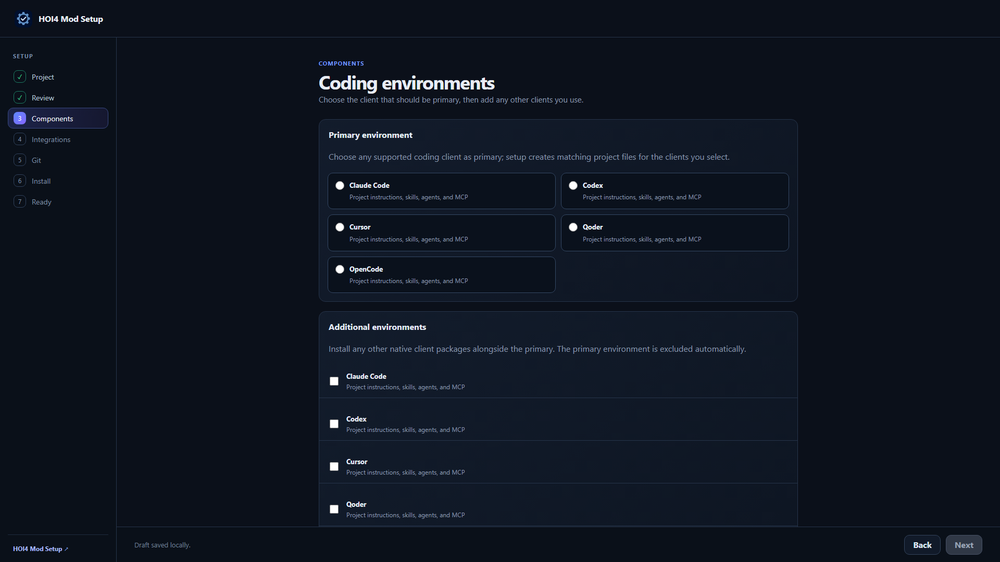
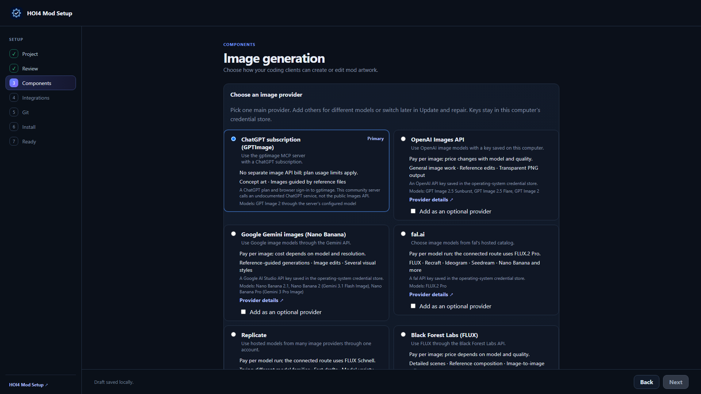
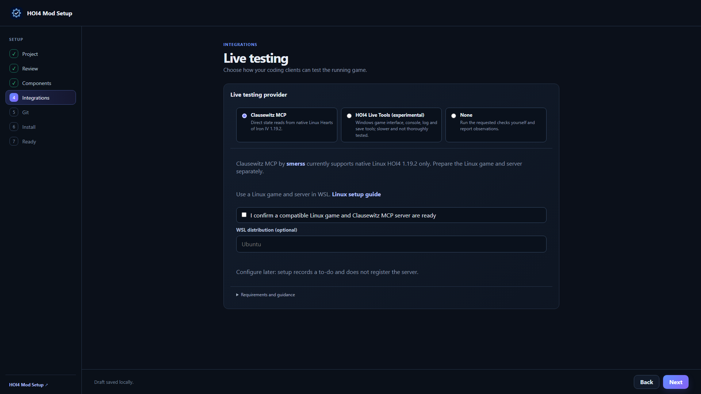

# Agentic HOI4 Modding

Build Hearts of Iron IV mods with your coding agent. Make focus trees, events, decisions and maps, fix broken script and balance the AI. Modding skills, specialist helpers, a HOI4 wiki for agents and HOI4 tools help your agent do the work.

Use Claude Code, Codex, Cursor, GitHub Copilot or one of many more coding clients. HOI4 Mod Setup creates project files and registers tools for the clients you select.

## Install with HOI4 Mod Setup

1. Download [HOI4 Mod Setup](https://github.com/klimPaskov/HOI4-Mod-Setup/releases/latest).
2. Choose a new mod or an existing Git project, then enter the mod name, prefix, game folder, and Workshop folder.
3. Select any supported coding client and the workflows you need: core modding, image generation, portraits, 3D, Super Events, or live testing.
4. Review the planned changes and install. Open the mod in your coding client, approve the project MCP server, and check the connection.

The app installs the MCP releases pinned in the package manifest. Its update and repair flows preserve local additions and let you review instruction conflicts. You can change the image and live-testing providers later and have the app update its MCP registrations and guidance.

The [first-run guide](https://github.com/klimPaskov/Agentic-HOI4-Modding/blob/main/docs/first-run.md) lists the prerequisites (Python 3.13 on Windows, a package-manager Node.js 22 on Linux) and how to check that your agent works.

[Setup app screenshots](https://github.com/klimPaskov/HOI4-Mod-Setup/tree/main/docs/screenshots) show the install and maintenance screens.

## Install manually

Use Python 3.13, Node.js LTS with npm, Git, and an installed copy of HOI4. Start from the [package source](https://github.com/klimPaskov/Agentic-HOI4-Modding) or [release ZIP](https://github.com/klimPaskov/Agentic-HOI4-Modding/releases/latest/download/Agentic-HOI4-Modding.zip).

Copy `CLAUDE_template.md` as `CLAUDE.md`, replace all mod and game-path placeholders, and remove optional workflow blocks you do not install. Copy `.claude/`, `.mcp.json`, `.tools/sync/`, `.tools/mcp/`, `hoi4_wiki/`, and the runtime and MCP integration guides into the mod. Run:

```powershell
python .tools/mcp/bootstrap_hoi4_agent_tools.py
```

For Codex, copy `.codex/`. For any other client, copy its files from `.tools/clients/` to the same paths in the mod (for example `.tools/clients/.cursor/` becomes `.cursor/`). Then generate its project files:

```powershell
python .tools/sync/sync_instructions.py
python .tools/sync/sync_agents.py --runtime codex
python .tools/sync/sync_skills.py --target agents
```

Replace `codex` with the runtime's key (`cursor`, `qoder`, `opencode`, `gemini`, `antigravity`, `kilo`, `kiro`, `qwen`, `devin`, or `augment`) as appropriate. Qoder, Grok Build, Kiro, and Qwen Code need `--target qoder`, `grok`, `kiro`, or `qwen`; Gemini CLI, Antigravity, Kilo Code, and Devin Desktop read the `.agents/skills` copy that `--target agents` creates; Cursor, OpenCode, GitHub Copilot, Cline, and Augment read the canonical skill root directly. On Windows, use `py -3.13` if `python` selects an older installation.

For optional workflows, copy the complete tools, references, and runtime assets declared in the manifest. Follow the [manual setup guide](https://github.com/klimPaskov/Agentic-HOI4-Modding/blob/main/docs/manual-setup.md) and [runtime reference](https://github.com/klimPaskov/Agentic-HOI4-Modding/blob/main/docs/runtimes.md).

## Skills and specialist agents

The [catalog](https://github.com/klimPaskov/Agentic-HOI4-Modding/blob/main/docs/catalog.md) covers focus trees, decisions, events, game systems, interfaces, assets, portraits, 3D models, live testing and Super Events. Describe the task; your agent chooses the skills and specialists it needs.

Specialist roles use model tiers matched to the work. The package maps those tiers to settings supported by each selected coding client.

## Image generation and modding tools

Images come from `hoi4-imagegen`, which HOI4 Mod Setup installs. It makes the 40 HOI4 asset families at the mod's canvas sizes (vanilla by default). Sign in once with your ChatGPT account, use an OpenAI, Gemini or fal key from the environment or a ComfyUI endpoint, or make art yourself. See the [provider research](../image-generation-providers.md) for models, access needs, costs, and size limits.

## Modding and live testing

**HOI4 Agent Tools** (`hoi4_agent_tools`) helps your agent build focus trees, events, decisions and maps, preview windows and trees, find modding rules, fix script and balance AI choices. The project bootstrap installs the release selected by the package manifest.

**HOI4 Live Tools** (`hoi4-live`) works with the running game on Windows: launch and load, events and effects, time advancement, popups, screen evidence, saves, and error-log changes. The app installs its runtime per user and writes project registrations for selected clients. For manual installation:

```powershell
python .tools/mcp/bootstrap_hoi4_live_tools.py
```

Reconnect the client and follow the [live-testing setup guide](https://github.com/klimPaskov/Agentic-HOI4-Modding/blob/main/.claude/skills/hoi4-live-playtest/references/setup.md). The optional 3D workflow adds Meshy and Blender MCP routes through its own bootstrap.

## Watch the workflow

- Updated video guides will be shared on [Chaos Redux on YouTube](https://www.youtube.com/@ChaosRedux).
- [Video tutorial playlist](https://www.youtube.com/playlist?list=PLh6JmuEabQioc4V8IYGEsMtqiw-xemeX3).







## License

Original package code and guidance use the [Apache License 2.0](https://github.com/klimPaskov/Agentic-HOI4-Modding/blob/main/LICENSE). Third-party material retains its own terms; see [NOTICE](https://github.com/klimPaskov/Agentic-HOI4-Modding/blob/main/NOTICE).

## Upgrade an older checkout

Back up and commit your mod work, then use the setup app to update or repair the package and MCP installation. Review custom instruction changes, regenerate runtime files for your selected coding clients, and reconnect them.

## Live-testing provider choice

HOI4 Mod Setup offers Clausewitz MCP (default), experimental HOI4 Live Tools, and manual testing. [Clausewitz MCP](https://github.com/smerss/Clausewitz-MCP) by smerss is MIT licensed and reads state directly from native Linux HOI4 **1.19.2 only**, without OCR or saves for those reads. Windows uses WSL; macOS uses SSH to Linux. Complete manual Linux/game/server setup and confirm the Linux game and server are ready in HOI4 Mod Setup before registration.

HOI4 Live Tools is Windows verified only; upstream macOS support is incomplete. It is experimental, slower and not thoroughly tested. The app installs its pinned runtime without global registration and manages project registrations for selected coding clients. Manual testing registers no server. Use update or repair to reselect the provider and clients, review changed guidance and registrations, and preserve custom instructions. Follow the selected server tool list; providers do not promise identical operations.
