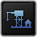
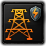

# Building modding

*Offline snapshot of the Hearts of Iron IV Wiki page "Building modding", revision 104005, captured 2026-10-31. Wiki text by the wiki's contributors under CC BY-SA 3.0 (see LICENSE.txt); kit blocks are local additions under the same license.*

<!-- kit:begin id="review" at="top" build="1.19.4.1" checked="2026-11-01" revision="104005" sources="common/buildings/ interface/countrystateview.gfx gfx/interface/buildings/building_icon_strip.dds gfx/entities/buildings.asset map/buildings.txt common/terrain/00_terrain.txt common/state_category/ common/special_projects/specialization/ common/defines/00_defines.lua localisation/english/ history/states/ documentation/effects_documentation.md documentation/triggers_documentation.md documentation/modifiers_documentation.md documentation/dynamic_variables_documentation.md" -->
**Kit review (HOI4 1.19.3.0, 2026-10-31).** Checked against: both files in `common/buildings/` (all 55 buildings parsed), the building defines, the building effects, triggers and modifier families, the icon strip, and the model position file.
Kit blocks added: every building key vanilla uses that the page lacks or has wrong, the full building list with costs and level caps, corrections (`special_icon` is a sprite name, `enable_for_controllers` needs `=`, `noOfFrames` is 31, the state modifier localisation key, `max_level` in the example), and the script that works with buildings.
The "need to be updated" marker is an instruction about the icon strip, not a stale section. The five footnoted defines all still have the quoted values.
Gaps left: what `affects_energy`, `need_detection`, `centered` and `base_cost_conversion` do is not stated in any game file; the blocks say `[unverified]`.
**1.19.4.1 re-check (2026-11-01).** 10 tagged statements depended on files the update changed (the defines file, `map/buildings.txt`, English localisation, state history, and scripts scanned for effect counts) and all were re-measured. One number moved: `add_offsite_building` is used in 98 files (was 99). Every other statement cites files that are byte-identical in 1.19.4.1 (Steam depot manifest diff).
<!-- kit:end id="review" -->

## Table of contents

- [Buildings](#Buildings)
  - [Cost](#Cost)
  - [Slots](#Slots)
  - [Modifiers](#Modifiers)
  - [Additional arguments](#Additional_arguments)
  - [Icon](#Icon)
  - [Models](#Models)
  - [Effects](#Effects)
  - [Example](#Example)
- [Spawn point](#Spawn_point)
- [Localization](#Localization)
- [Types](#Types)
- [References](#References)
- [Kit: Script that works with buildings](#kit-building-script-surface)

---

A building is a structure built using Civilian factories in states or provinces.

## Buildings <a id="Buildings"></a>

Buildings are defined within `/Hearts of Iron IV/common/buildings/*.txt`. Each building entry lies within the `buildings = { ... }` block, serving as its own block with arguments within defining the building, as this:

```text
buildings = {
    my_building = {
        <...>
    }
}
```

### Cost <a id="Cost"></a>

Each building has a set price in industrial capacity required.

This cost is defined with:

- `base_cost = <int>` - Required base cost of building.
- `per_level_extra_cost = <int>` - Optional additional cost per building in state/province.
- `per_controlled_building_extra_cost = <int>` - Optional additional cost per building controlled by country.

`base_cost` is the primary cost to build the building, added to each building level, `per_level_extra_cost` gets added for each building level in state or province in an arithmetic progression. With the example of 1000 base_cost and 100 per_level_extra_cost, the first level will cost 1000 IC to build, while the 5th level will cost 1400 IC, as 4 levels have been built before that. `per_controlled_building_extra_cost` adds additional cost per building controlled by country.

By default, each civilian factory provides 4 IC per day[1], which can be taken into account when calculating the cost. For comparison, by default a civilian factory costs 10800 IC, while infrastructure costs 6000 IC.

Additionally, `infrastructure_construction_effect = yes`, if included, will make the building get the building speed boost from any infrastructure built in the state. Maximum infrastructure level increase buidling speed by factor of 1[2]. Dividing that value by `level_cap` of infrastructure (5) gives a +20% boost per infastructure level.

<!-- kit:begin id="building-cost-notes" at="section:Cost" -->
**Kit note** Cost keys used in vanilla: `base_cost` (all 55 buildings), `per_level_extra_cost` (5), `per_controlled_building_extra_cost` (5, on the facilities and the naval headquarters) and `base_cost_conversion` (2: `arms_factory` 4000 and `industrial_complex` 9000). [vanilla-confirmed 1.19.3] `common/buildings/00_buildings.txt`

- `per_level_extra_cost` may be negative: `fuel_silo` uses `-500`, so each extra level is cheaper. [vanilla-confirmed 1.19.3] `common/buildings/00_buildings.txt`
- What `base_cost_conversion` does is not stated in any game file; it appears only on the two factory types, which suggests a factory conversion cost. [unverified]
- The "4 IC per day" figure is the base speed of an unpowered factory. 1.19.4.1 has separate defines: `BASE_FACTORY_SPEED = 4`, `BASE_FACTORY_SPEED_MIL = 3.5`, `BASE_FACTORY_SPEED_NAV = 2.0`, and for powered factories (the energy system) `POWERED_FACTORY_SPEED = 5`, `POWERED_FACTORY_SPEED_MIL = 4.5`, `POWERED_FACTORY_SPEED_NAV = 2.5`, all in `NProduction`. [vanilla-confirmed 1.19.4.1] `common/defines/00_defines.lua`
- Modifiers that act on one building type: `production_cost_<Building>_factor` (cost), `production_speed_<Building>_factor` (speed) and `repair_speed_<Building>_factor` at country level, and `state_production_speed_<Building>_factor` and `state_repair_speed_<Building>_factor` at state level. The documentation lists all 55 buildings for each of these five families. [docs] `documentation/modifiers_documentation.md`
<!-- kit:end id="building-cost-notes" -->

### Slots <a id="Slots"></a>

In general, buildings fall into 3 categories by used building slots:

- Shared, which use the same, by default, 25 shared slots[3] for each state, such as civilian and military factories.
- Non-shared, defined for states, but using slots that are unique for each building in particular, such as infrastructure or air bases.
- Provincial, which get built for each province, using slots that are unique for each building in particular, such as forts or naval bases.

The 3 categories have separate zones in the country construction view where they are located.

Slot for building is defined inside `level_cap` block. Which possible parameters are:

- `shares_slots = <bool>` - Wheter building should use shared slots for state.
- `state_max = <int>` - Maximum level in a state.
- `province_max = <int>` - Maximum level in a province. Defines building as provincial.
- `group_by = <string>` - Group of buildings, limiting all building with the same category to the same maximum used slots.
- `exclusive_with = <building_id>` - Prohibits the construction of certain buildings in the same state/province.

By default building is defined as state building. If `state_max` is unspecified, it gets assumed to be 15[4] by default.

Additional maximum level limit for provincial buldings for each terrain type can be set within `/Hearts of Iron IV/common/terrain/*.txt` files.

```text
buildings_max_level = {
  bunker = <int>
  coastal_bunker = <int>
}
```

By default, all levels of the building are unlocked by default. However, if there are [technologies](<technology_modding.md>) that enable construction of this building to a specified level, it becomes impossible to build without obtaining at least one of these technologies. It is to be noted that the [add_building_construction effect](<effects.md>) or the [starting state buildings](<state_modding.md#Buildings>) can still be used to bypass the technological limit, while still not being possible to bypass the max level total.

<!-- kit:begin id="building-slot-notes" at="section:Slots" -->
**Kit note** `level_cap` keys as vanilla uses them. All rows: [vanilla-confirmed 1.19.3] `common/buildings/*.txt`.

| Key | Buildings using it | Notes |
| --- | --- | --- |
| `province_max` | 38 | makes the building provincial |
| `state_max` | 20 | the facilities set both `province_max = 1` and `state_max = 1` (one per province and one per state) |
| `shares_slots` | 13 | `yes` = uses the shared slots of the state |
| `group_by` | 9 | values `special_project_facility` (4 facilities), `reactors` (3 reactors), `infrastructure_keystone` (2 grids) |
| `exclusive_with` | 2 | `mega_gun_emplacement` and `rocket_site` exclude each other |

`fuel_silo` has `shares_slots = yes` and no `state_max`, so its cap is `MAX_BUILDING_LEVELS = 15`, the default the wiki states. Also in `NBuildings`: `MAX_SHARED_SLOTS = 25` and `OWNER_CHANGE_EXTRA_SHARED_SLOTS_FACTOR = 1`. [vanilla-confirmed 1.19.4.1] `common/defines/00_defines.lua`

Three more places cap levels. Terrain: only `bunker` (3, 4 or 5) and `coastal_bunker` (6) appear in `buildings_max_level` blocks of `common/terrain/00_terrain.txt`. State categories: the island categories carry `buildings_max_level = { naval_base = N air_base = N }` (see the State modding page). Modifiers: `<Building>_max_level_terrain_limit` and `state_<Building>_max_level_terrain_limit`, plus per-terrain forms such as `air_base_desert_max_level_terrain_limit` (building name plus terrain name, 770 combinations). The two plain families list 54 buildings, all but `dam_mountain`. [vanilla-confirmed 1.19.3] `common/terrain/00_terrain.txt`, `common/state_category/`. [docs] `documentation/modifiers_documentation.md`

The slots a state offers come from its category (`local_building_slots`), and the modifiers `local_building_slots`, `local_building_slots_factor`, `global_building_slots` and `global_building_slots_factor` change them. [docs] `documentation/modifiers_documentation.md`
<!-- kit:end id="building-slot-notes" -->

### Modifiers <a id="Modifiers"></a>

Bulding can provide modifiers to country or/and state:

- `country_modifiers = { modifiers = { ... } }` - Accept only country modifiers.
- `state_modifiers = { ... }` - Accept only state modifiers.

Country modifiers can be restricted to specific countries by `enable_for_controllers = { ... }` list of tags block inside `country_modifiers`. Modifiers will apply only if the controller of province/state is in the list, or if the list is empty.

Adding `show_modifier = yes` will make the modifiers show up in the tooltip of the building.

Example:

```text
building = {
  country_modifiers = {
    enable_for_controllers { GER ENG }
    modifiers = {
       political_power_factor = 2.0
    }
  }
  state_modifiers = {
    local_building_slots_factor = 2
  }
}
```

<!-- kit:begin id="building-modifier-syntax" at="section:Modifiers" -->
**Kit correction** The example above leaves out the equals sign. Vanilla writes `enable_for_controllers = { ENG }` (22 times, all in `01_landmark_buildings.txt`); the form without `=` appears only in the comment copied into the example. [vanilla-confirmed 1.19.3] `common/buildings/01_landmark_buildings.txt`

```text
country_modifiers = {
	enable_for_controllers = { ENG }
	modifiers = {
		political_power_factor = 0.03
	}
}
```

`country_modifiers` is used by 28 buildings, `state_modifiers` by 9 and `show_modifier = yes` by 33. A building can use several `state_modifiers` keys, for example the dams: `state_production_speed_buildings_factor`, `local_building_slots_factor`, `state_resources_factor` and `local_factory_energy_consumption`. [vanilla-confirmed 1.19.3] `common/buildings/00_buildings.txt`
<!-- kit:end id="building-modifier-syntax" -->

### Additional arguments <a id="Additional_arguments"></a>

Common arguments applicable to every building:

- `dlc_allowed = { ... }` - Limit building to specific dlc. Uses [has_dlc](<triggers.md>) trigger.
- `special_icon = <int>` - Used to display icons for specific buildings starting from the left side of the terrain interface within the state interface.(See provinces with facilities for details.)
- `value = 3` - Decides the base health of a building for air bombing campaigns, which gets multiplied for each level of the building. Additionally, this also determines the price of the state to get during peace conferences or the cost in Political Power to occupy.
- `damage_factor = 0.3` - Modifies the damage that this building gets from air bombing or land combat. Positive values increase it, while negatives decrease it. At 0, building can't be damaged.
- `allied_build = <bool>` - If set to yes, makes the building buildable by your faction members on your land.
- `only_costal = yes` (sic) - If specified, will make the building only be possible to build in either provinces that are [defined as coastal](<map_modding.md>) or states that contain any such provinces, depending on the type of the building.
- `disabled_in_dmz = <bool>` - If added, will make the building impossible to build or use in states that are demilitarised zones.
- `need_supply = <bool>` - Whether building needs supply for operation.
- `hide_if_missing_tech = <bool>` - Hides building in the construction tab if the required technology has not been researched.
- `missing_tech_loc = { ... }` - Custom localized tooltip when the required technology has not been researched.
- `need_detection = <bool>` - ?
- `detecting_intel_type = <intel_type>` - Define what type of intelligence affects this building.Types of intelligence available:`civilian`,`army`,`airforce`,`navy`
- `only_display_if_exists = <bool>` - The details of the building will only appear in the terrain interface of the province when it is constructed in a province of that state.(Usually used in conjunction with the special_icon parameter mentioned above.)At the same time, the terrain interface maps of other provinces in the state will not show the icon of this building. If set to 'no', all provinces in the entire state will display the icon and detailed information of the building, but provinces without the building will show a level of 0, even though this building can only be constructed once within the same state.
- `specialization = { ... }` - Associate the types of special projects.Defined in this path:`/Hearts of Iron IV/common/special_projects/specialization/specializations.txt`
- `tags = { ... }` - Building tags, used to target buildings in raids and in [damage_building](<effects.md>) effect.
- `is_buildable = <bool>` - Whether building can be build manually. Default to yes.
- `province_damage_modifiers = { ... }` - Modifiers to add to province if building is damaged/destroyed. `[Need confirmation]`
- `state_damage_modifier = { ... }` - Modifiers to add to state if building is damaged/destroyed. `[Need confirmation]`
- `affects_energy = yes/no` - Determine whether the building will affect energy consumption.`[Need confirmation]`

<!-- kit:begin id="building-argument-notes" at="section:Additional_arguments" -->
**Kit correction** `special_icon` takes a sprite name, not an integer. All 31 vanilla uses are `GFX_...` names (for example `special_icon = GFX_specialization_naval`, `GFX_dam_icon_small`). [vanilla-confirmed 1.19.3] `common/buildings/*.txt`

**Kit addition** Arguments vanilla uses that the list above lacks, or marks as unknown. All rows: [vanilla-confirmed 1.19.3] `common/buildings/*.txt` (counts are buildings).

| Key | Count | Form and use |
| --- | --- | --- |
| `dlc_allowed` | 25 | `dlc_allowed = { has_dlc = Gotterdammerung }`; other values seen: `"No Compromise, No Surrender"`, `"Graveyard of Empires"`, `"Peace For Our Time"` (a single word such as Gotterdammerung is unquoted) |
| `missing_tech_loc` | 3 | a block, not a plain key: `missing_tech_loc = { localization_key = SP_BUILDING_MISSING_PROJECT PROJECT = sp_nuclear_reactor }` |
| `hide_if_missing_tech` | 5 | `yes` on `stronghold_network`, `mega_gun_emplacement` and the three reactors |
| `building_prerequisite` | 2 | `building_prerequisite = { building_dependency = { building = naval_base level = 8 } }` on `naval_supply_hub` and `naval_headquarters` |
| `modules` | 1 | `modules = { naval_leader_module }` on `naval_headquarters` |
| `need_detection` | 7 | `yes` on the facilities and the three dam types; the wiki's `?`. The effect is not stated in any game file [unverified] |
| `detecting_intel_type` | 6 | `civilian` (3 dams), `army`, `airforce`, `navy` (one facility each), as the wiki says |
| `province_damage_modifiers` | 3 | `{ flooded }` on the dams, a static modifier (`common/modifiers/00_static_modifiers.txt`, "on Province"). Resolves the wiki's "need confirmation" |
| `state_damage_modifier` | 2 | `{ kiel_canal_damaged_modifier }` and `{ panama_canal_damaged_modifier }` on the canals, dynamic modifiers (`common/dynamic_modifiers/`). Resolves the wiki's "need confirmation" |
| `affects_energy` | 6 | `yes` on `infrastructure`, `commercial_nuclear_reactor`, the three dams and `energy_infrastructure`. The effect is not stated in any game file [unverified] |
| `tags` | 16 | tags used: `supply_building`, `facility`, `naval_buildings_tag`, `specialization_nuclear`, `dam_building`, `locks_building` |
| `specialization` | 4 | `specialization_naval`, `specialization_nuclear`, `specialization_air`, `specialization_land` |
| `is_buildable` | 27 | `no` on the 3 dams, 2 canals and 22 landmarks |
| `allied_build` | 5 | `infrastructure`, `air_base`, `supply_node`, `naval_base`, `radar_station` |
| `repair_speed_factor` | 22 | the landmarks, via `@landmark_repair_speed_factor = 0.15` (default factor 1.0) |
| `disable_grow_animation`, `drawn_at_distance` | 22, 20 | the landmarks |
| `only_display_if_exists` | 31 | see the wiki text above |

The `damage_factor` values in vanilla are `0` (cannot be damaged by strategic bombing, as the wiki says), `-1` on dams and canals, and small positives such as `0.1` to `0.5`. [vanilla-confirmed 1.19.3] `common/buildings/00_buildings.txt`

`specialization` names are defined in `common/special_projects/specialization/specializations.txt`, as the wiki says. [vanilla-confirmed 1.19.3] file listing of `common/special_projects/specialization/`
<!-- kit:end id="building-argument-notes" -->

### Icon <a id="Icon"></a>

The building icon is defined as `icon_frame = 10`. The integer shows which frame within the GFX_buildings_strip sprite gets used for this building.

By default, GFX_buildings_strip is defined within `/Hearts of Iron IV/interface/countrystateview.gfx`, however, it can be overwritten in any `/Hearts of Iron IV/interface/*.gfx` which is positioned later by filename order:

```text
spriteType = {
    name = "GFX_buildings_strip"
    textureFile = "gfx/interface/buildings/building_icon_strip.dds"
    noOfFrames = 16     # As of 1.11
}
```

The noOfFrames decides in how many frames the specified sprite is divided into, dividing the image horizontally into chunks of approximately equal width. If planning to add a new building icon rather than using a base game one, the building icon strip will need to be updated both in the noOfFrames and in the .dds file. By default, each building has a 46x46 resolution in pixels.

Within the building construction menu, buildings are divided into 3 zones depending on their used building slots category. In order to change where they are to adjust for new or missing buildings, the elements within the possible_constructions container in `/Hearts of Iron IV/interface/countryconstructionsview.gui` can have their positions changed.

<!-- kit:begin id="building-icon-correction" at="section:Icon" -->
**Kit correction** In 1.19.3 `GFX_buildings_strip` has `noOfFrames = 31`, not 16. `gfx/interface/buildings/building_icon_strip.dds` is 1426 x 46 pixels, which is 31 frames of 46 x 46, and the highest `icon_frame` in use is 31 (`industrial_infrastructure`). [vanilla-confirmed 1.19.3] `interface/countrystateview.gfx`, DDS header of the strip, `common/buildings/00_buildings.txt`

`icon_frame` is 1-based: `infrastructure` is 3, `arms_factory` 2, `industrial_complex` 1. All landmarks share frame 22. [vanilla-confirmed 1.19.3] `common/buildings/*.txt`
<!-- kit:end id="building-icon-correction" -->

### Models <a id="Models"></a>

*Main article: [Entity modding](<entity_modding.md>)*

There are several arguments related to models within buildings.
`show_on_map = 3` decides how many building models should there be per state or per province (depending on the building type) defined for the building. Each building construction will add one more model. If unspecified, will have no map models.
`show_on_map_meshes = 2` decides how many entities are used for each building model. By default assumed to be 1.
`always_shown = yes`, if specified, will make the building model appear regardless whether it's covered by the fog of war or not.
`has_destroyed_mesh = yes`, if specified, will make the game use a separate model if the building has been destroyed by air bombing or occupation.
`centered = yes`, if specified, will mak

In order to assign an entity to a building, it must have a name of `building_<building name>`, like `building_my_building`, within the `/Hearts of Iron IV/gfx/entities/*.asset` file. If a building is set to use several entities, then the number will get appended in the end like `building_my_building_1`, starting with 1. If there's a destroyed mesh, then it'll append _destroyed in the end as `building_my_building_destroyed`

The locations of building models for each state are defined in `/Hearts of Iron IV/map/buildings.txt`. An entry in that file is defined as such (If unspecified, assume a number with up to 2 decimal digits):

```text
State ID (integer); building ID (string); X position; Y position; Z position; Rotation; Adjacent sea province (integer)
```

- State ID defines which state the building is located in. Even for provincial buildings, this is the ID of the state, not the province. Instead, provincial buildings have several entries per state, with the XYZ position being used by the game to know which province it's for.
- Building ID is defines which model is being located. While this includes each building, this also includes floating harbours as floating_harbor.
- X, Y, and Z position represent the position on the map of the building model using the 3-dimensional Cartesian coordinate system. The X and Z positions are equivalent to the X and Y axes on the province bitmap with 1 pixel equalling 1 unit, left-to-right and down-to-up respectively. This is also what the game uses to know which province it's for for provincial buildings. The Y position, on the scale of 0 to 25.5, can be calculated with the heightmap by taking the colour value of the pixel at that position and making it fit on the scale of 0 to 25.5 (Such as by dividing it by 10 if it's on the scale of 0 to 255).
- Rotation is measured in radians. A rotation of 0 will result in the building model pointing in the same direction as the model is set, while positives will rotate it counter-clockwise and negatives will rotate it clockwise. A full rotation resulting in the same position as 0 is equal to the number π multiplied by 2, roughly 6.28.
- Adjacent sea province is only necessary to define for naval bases and floating harbours, in order to let the game know from which sea province ships or convoys can access the land province where it is located. If the building type is not a naval base, it should be left at 0.

It is preferable to generate the building models in the building section in the nudger, rather than filling it out manually. However, note that the game will crash if the currently-existing `/Hearts of Iron IV/map/buildings.txt` file is entirely empty, so there should be at least one definition, even if incorrect.

<!-- kit:begin id="building-model-notes" at="section:Models" -->
**Kit note** The sentence above about `centered = yes` is cut off in the wiki capture. In vanilla `centered = yes` is set on `supply_node` and `radar_station` only; its effect is not stated in any game file. [unverified] `common/buildings/00_buildings.txt`

Other model keys in vanilla: `show_on_map_meshes = 3` (`naval_base`, `dockyard`; entities `building_dockyard_1` to `building_dockyard_3` exist), `has_destroyed_mesh = yes` (`bunker`, `coastal_bunker`, `stronghold_network`) and `always_shown = yes` (26 buildings). The entities are in `gfx/entities/buildings.asset` (107 entities named `building_*`). [vanilla-confirmed 1.19.3] `common/buildings/00_buildings.txt`, `gfx/entities/buildings.asset`

In `map/buildings.txt` the second column is the building id or, for a building with `spawn_point = X`, the spawn point name `X`. Vanilla has 66664 rows and 22 distinct ids: the spawn names `naval_base_spawn`, `special_project_facility_spawn`, `rocket_site_spawn`, `nuclear_reactor_spawn`, `dam_spawn`, `locks_spawn`, `landmark_spawn`, the building ids `air_base`, `anti_air_building`, `arms_factory`, `bunker`, `coastal_bunker`, `dockyard`, `fuel_silo`, `industrial_complex`, `naval_headquarters`, `naval_supply_hub`, `radar_station`, `stronghold_network`, `supply_node`, `synthetic_refinery`, and `floating_harbor`. There are 10154 `supply_node` rows, the same as the number of land provinces. [vanilla-confirmed 1.19.4.1] `map/buildings.txt`
<!-- kit:end id="building-model-notes" -->

### Effects <a id="Effects"></a>

Each building can accept any [state-scoped modifier](<modifiers.md#State_scope>) within itself, applying that to the state when built. Some used in base game include `local_resources_<resource>`, `air_defence` (for anti-air) and `air_defence`. In case of provincial buildings, province-level modifiers are accepted instead. This can also be used with [modifier tokens](<modifiers.md>) to create a custom effect as a variable system.

Aside from state-scoped modifiers, there are several other arguments to make the building have the same effect as a base game building or be considered one for the AI:

| Name | Effects | Examples | Type | Notes |
| --- | --- | --- | --- | --- |
| military_production | Adds the specified amount of military factories to the controller. | `military_production = 0.5` | Flat. | A value that's larger than 1 will be the same as 1 factory, but it can fall between 0 and 1. |
| general_production | Adds the specified amount of civilian factories to the controller. | `general_production = 0.5` | Flat. | A value that's larger than 1 will be the same as 1 factory, but it can fall between 0 and 1. |
| naval_production | Adds the specified amount of dockyards to the controller. | `naval_production = 0.5` | Flat. | A value that's larger than 1 will be the same as 1 factory, but it can fall between 0 and 1. |
| infrastructure | Makes the building be marked as infrastructure. | `infrastructure = yes` | Boolean. | Includes the construction speed bonus and extra resources. |
| air_base | Makes the building be marked as an air base. | `air_base = yes` | Boolean. |  |
| supply_node | Makes the building be marked as a supply node. | `supply_node = yes` | Boolean. |  |
| is_port | Makes the building be marked as a naval port. | `is_port = yes` | Boolean. |  |
| land_fort | Adds that many land forts to the province. | `land_fort = 1` | Flat. |  |
| naval_fort | Adds that many coastal forts to the province. | `naval_fort = 1` | Flat. |  |
| refinery | Makes the building be marked as a synthetic refinery. | `refinery = yes` | Boolean. |  |
| fuel_silo | Makes the building be marked as a fuel silo. | `fuel_silo = yes` | Boolean. |  |
| radar | Makes the building be marked as a radar station. | `radar = yes` | Boolean. |  |
| rocket_production | Defines how much progress on rocket production is done daily. | `rocket_production = 5` | Flat. |  |
| rocket_launch_capacity | Defines how many rockets the build can launch daily. | `rocket_launch_capacity = 5` | Flat. |  |
| nuclear_reactor | Makes the building be marked as a nuclear reactor. | `nuclear_reactor = yes` | Boolean. |  |
| gun_emplacement |  | `gun_emplacement = yes` | Boolean. |  |

<!-- kit:begin id="building-property-keys" at="section:Effects" -->
**Kit addition** Building properties that vanilla uses and the table above lacks. They are keys of the building definition, not modifiers. All rows: [vanilla-confirmed 1.19.3] `common/buildings/00_buildings.txt`.

| Key | Used by | Value |
| --- | --- | --- |
| `anti_air` | `anti_air_building` | `yes` |
| `air_defence` | `anti_air_building` | `1`; the modifier documentation has `air_defence_factor` but no plain `air_defence` [docs] `documentation/modifiers_documentation.md`. Whether the wiki sentence above is right to group it with state modifiers is [unverified] |
| `local_resources_<resource>` | `synthetic_refinery` (`local_resources_rubber = 1`, a commented `local_resources_oil`) | the comment in the file says any resource name may follow |
| `naval_supply_hub` | `naval_supply_hub` | `yes` |
| `naval_headquarter` | `naval_headquarters` | `yes` (singular key) |
| `nuclear_reactor` | the three reactors | `yes` |
| `rocket_production`, `rocket_launch_capacity` | `rocket_site` | `0` and `1` |
| `military_production`, `general_production`, `naval_production` | `arms_factory`, `industrial_complex`, `dockyard` | `1` each |

Keys already in the table are used as: `land_fort = 1` on `bunker`, `naval_fort = 1` on `coastal_bunker`, `is_port = yes` on `naval_base`, `refinery = yes`, `fuel_silo = yes`, `radar = yes`, `gun_emplacement = yes`, `infrastructure = yes` and `air_base = yes` and `supply_node = yes` on the buildings of the same name. A building with none of these keys is just a state or country modifier carrier, like the two electrical grids.
<!-- kit:end id="building-property-keys" -->

### Example <a id="Example"></a>

```text
buildings = {
    my_provincial_building = {
        base_cost = 10000
        infrastructure_construction_effect = yes

        value = 1

        icon_frame = 17

        show_on_map = 1
        always_shown = yes

        spawn_point = my_provincial_building_spawn

        country_modifiers = {
            modifiers = {
                army_attack_factor = 0.01
                army_defence_factor = 0.01
            }
        }

        level_cap = {
            province_max = 3
        }
    }
    my_shared_building = {
        base_cost = 1000
        per_level_extra_cost = 200
        infrastructure_construction_effect = yes

        value = 15
        only_costal = yes

        icon_frame = 18

        show_on_map = 3
        show_on_map_meshes = 3
        has_destroyed_mesh = yes

        military_production = 1
        general_production = 1
        naval_production = 1

        level_cap = {
            shares_slots = yes
            # Max level of 15 since undefined
        }
    }
    my_non_shared_building = {
        base_cost = 1000
        per_level_extra_cost = 2000

        max_level = 2

        value = 5

        icon_frame = 19     # No model is defined

        state_modifiers = {
            recruitable_population_factor = 0.5
        }

        level_cap = {
            state_max = 2
        }
    }
}
```

<!-- kit:begin id="building-example-note" at="section:Example" -->
**Kit correction** `max_level = 2` in `my_non_shared_building` is not a building key. No vanilla building uses it; the cap is `level_cap = { state_max = 2 }`, which the example also sets. Leave `max_level` out. [vanilla-confirmed 1.19.3] `common/buildings/*.txt`

The modifiers the examples use (`recruitable_population_factor`, `army_attack_factor`, `army_defence_factor`, `political_power_factor`, `local_building_slots_factor`) exist in the modifier documentation. [docs] `documentation/modifiers_documentation.md`
<!-- kit:end id="building-example-note" -->

## Spawn point <a id="Spawn_point"></a>

Coordinates for each building on map by default are defined using building name. Spawn point can be defined to to use 1 position for diffrent types of buildings.

Parameters:

- `type` - Can be `state` or `province`.
- `max = <int>` - How many spawn points state/province should have.
- `only_costal = <bool>` - Limit spawn point to coastal states/provinces.
- `disable_auto_nudging = <bool>` - Disable automatic positioning with nudging tool.

Example:

```text
spawn_points = {
  my_building_type_spawn = {
    type = state
    max = 1
  }
  my_province_building_type_spawn = {
    type = province
    max = 1
    only_costal = yes
  }
}
```

Now multiple buildings can use `spawn_point = my_building_type_spawn`.

<!-- kit:begin id="building-spawn-notes" at="section:Spawn_point" -->
**Kit note** `spawn_points = { ... }` sits in the same file as `buildings = { ... }` (a second top-level block). Vanilla defines seven; a building opts in with `spawn_point = <name>` (37 buildings). [vanilla-confirmed 1.19.3] `common/buildings/00_buildings.txt`, `common/buildings/01_landmark_buildings.txt`

| Spawn point | `type` | Extra keys |
| --- | --- | --- |
| `nuclear_reactor_spawn` | state | `max = 1` |
| `rocket_site_spawn` | state | `max = 1` (also used by `mega_gun_emplacement`) |
| `special_project_facility_spawn` | province | `max = 1` |
| `naval_base_spawn` | province | `max = 1`, `only_costal = yes` |
| `dam_spawn`, `locks_spawn`, `landmark_spawn` | province | `max = 1`, `disable_auto_nudging = yes` |
<!-- kit:end id="building-spawn-notes" -->

## Localization <a id="Localization"></a>

Buildings use the following localization keys, using my_building as an example:

```yaml
 my_building: "My building"
 my_building_desc: "My building's description"
 my_building_plural: "My buildings"

 modifier_production_speed_my_building_factor: "§Y$my_building$§! construction speed"
 modifier_production_speed_my_building_factor_desc: "Modifies the speed of §Y$my_building$§! construction."
 modifier_state_production_my_building_factor: "§Y$my_building$§! construction speed"
 modifier_state_production_my_building_factor_desc: "Modifies the speed of §Y$my_building$§! construction in this state."
```

The first 3 are used for the building itself in various UI elements, while the last 4 are used to localise the modifiers automatically created for each building: `production_speed_<building>_factor` and `state_production_speed_<building>_factor`.

<!-- kit:begin id="building-loc-correction" at="section:Localization" -->
**Kit correction** The last two keys in the list above are wrong. The state modifier key is `modifier_state_production_speed_<building>_factor` (with `speed`), matching the modifier `state_production_speed_<building>_factor` that the wiki names below it. Vanilla: `modifier_state_production_speed_infrastructure_factor` and its `_desc`. [vanilla-confirmed 1.19.4.1] `localisation/english/`

Vanilla also localises the other families, for example `modifier_repair_speed_infrastructure_factor` and `modifier_state_repair_speed_bunker_factor`, and uses `$bunker$` references inside the text. The building names themselves are plain keys: `infrastructure`, `infrastructure_desc`, `infrastructure_plural`. [vanilla-confirmed 1.19.4.1] `localisation/english/`
<!-- kit:end id="building-loc-correction" -->

## Types <a id="Types"></a>

These are the different types of buildings in the game (Can also be found inside `/Hearts of Iron IV/common/buildings/00_buildings.txt`):

| Icon | Localised name | Internal name | Maximum level | Type |
| --- | --- | --- | --- | --- |
|  | Infrastructure | infrastructure | 5 | Non-shared |
|  | Military factory | arms_factory | 20 | Shared |
|  | Civilian factory | industrial_complex | 20 | Shared |
|  | Air base | air_base | 10 | Non-shared |
|  | Supply hub | supply_node | 1 | Provincial |
|  | Railway | rail_way | 5[5] | Provincial |
|  | Naval Engineering Facility | naval_facility | 1 | Provincial |
|  | Naval base | naval_base | 10 | Provincial |
|  | Land fort | bunker | 10 | Provincial |
|  | Coastal fort | coastal_bunker | 10 | Provincial |
|  | Stronghold Network | stronghold_network | 1 | Shared |
|  | Naval dockyard | dockyard | 20 | Shared |
|  | Anti-air | anti_air_building | 5 | Non-shared |
|  | Synthetic refinery | synthetic_refinery | 3 | Shared |
|  | Fuel silo | fuel_silo | 15 | Shared |
|  | Radar station | radar_station | 6 | Non-shared |
|  | Multi-Charge Large Caliber Gun(\*) | mega_gun_emplacement | 1 | Shared |
|  | Rocket site(\*) | rocket_site | 3 | Shared |
|  | Naval supply hub (\*) | naval_supply_hub | 1 | Provincial |
|  | Naval headquarters (\*) | naval_headquarters | 1 | Provincial |
|  | Nuclear reactor | nuclear_reactor | 1 | Shared |
|  | Heavy Water Nuclear Reactor | nuclear_reactor_heavy_water | 1 | Shared |
|  | Civilian Nuclear Reactor | commercial_nuclear_reactor | 1 | Shared |
|  | Nuclear Research Facility | nuclear_facility | 1 | Provincial |
|  | Aerodynamics and Avionics Facility | air_facility | 1 | Provincial |
|  | Land Warfare Facility | land_facility | 1 | Provincial |
|  | Dam | dam | 1 | Provincial |
|  | Dam | dam_mountain | 1 | Provincial |
|  | Kiel Canal Locks | canal_kiel | 1 | Provincial |
|  | Panama Canal Locks | canal_panama | 1 | Provincial |
|  | Reinforced electrical grid(\*) | energy_infrastructure | 1 | Shared |
|  | High capacity electrical grid(\*) | industrial_infrastructure | 1 | Shared |

Note that while railways and supply nodes are buildings, not all traditional building operations apply to them. Their starting level is defined [outside of state history](<map_modding.md>) and [a separate effect](<effects.md>) must be used to construct railways mid-game, with the default [add_building_construction](<effects.md>) or other building-related effects crashing the game.

<!-- kit:begin id="building-types-all" at="section:Types" -->
**Kit correction** The table above lists 32 of the 55 buildings in 1.19.3 and gives `rail_way` a maximum of 5. `common/buildings/00_buildings.txt` defines 33 buildings (the table lacks `cataract_dam_mountain`) and `01_landmark_buildings.txt` defines 22 more, all `landmark_*`. In the file `rail_way` has `province_max = 1`; the maximum railway level is the define `NSupply.MAX_RAILWAY_LEVEL = 5`, as footnote 5 says. [vanilla-confirmed 1.19.4.1] `common/buildings/00_buildings.txt`, `common/defines/00_defines.lua`

All 33 buildings of `00_buildings.txt` as 1.19.3 defines them. "Kind" follows the page's wording: shared slots, state-level own slots, or provincial. Cost is `base_cost`, with extra cost terms in brackets. All rows: [vanilla-confirmed 1.19.3] `common/buildings/00_buildings.txt`.

| Building | Kind | Level cap | Cost | Flags |
| --- | --- | --- | --- | --- |
| `infrastructure` | Non-shared | state 5 | 6000 |  |
| `arms_factory` | Shared | state 20 | 7200 (conversion 4000) |  |
| `industrial_complex` | Shared | state 20 | 10800 (conversion 9000) |  |
| `air_base` | Non-shared | state 10 | 1250 |  |
| `supply_node` | Provincial | province 1 | 20000 |  |
| `rail_way` | Provincial | province 1 | 170 (+130/level) |  |
| `naval_facility` | Provincial | province 1, state 1 | 10000 (+6000/building owned) | coastal only; group special_project_facility; spawn naval_base_spawn |
| `naval_base` | Provincial | province 10 | 5000 (+1000/level) | coastal only; spawn naval_base_spawn |
| `bunker` | Provincial | province 10 | 500 (+500/level) |  |
| `coastal_bunker` | Provincial | province 10 | 500 (+500/level) | coastal only |
| `stronghold_network` | Shared | state 1 | 20000 | DLC |
| `dockyard` | Shared | state 20 | 6400 | coastal only |
| `anti_air_building` | Non-shared | state 5 | 2500 |  |
| `synthetic_refinery` | Shared | state 3 | 14500 |  |
| `fuel_silo` | Shared | state 15 (default) | 5000 (-500/level) |  |
| `radar_station` | Non-shared | state 6 | 3375 |  |
| `mega_gun_emplacement` | Shared | state 1 | 20000 | DLC; excludes rocket_site; spawn rocket_site_spawn |
| `rocket_site` | Shared | state 3 | 6400 | excludes mega_gun_emplacement; spawn rocket_site_spawn |
| `naval_supply_hub` | Provincial | province 1 | 12500 | coastal only |
| `naval_headquarters` | Provincial | province 1 | 10000 (+5000/building owned) | DLC; coastal only |
| `nuclear_reactor` | Shared | state 1 | 30000 | group reactors; spawn nuclear_reactor_spawn |
| `nuclear_reactor_heavy_water` | Shared | state 1 | 25000 | group reactors; spawn nuclear_reactor_spawn |
| `commercial_nuclear_reactor` | Shared | state 1 | 35000 | DLC; group reactors; spawn nuclear_reactor_spawn |
| `nuclear_facility` | Provincial | province 1, state 1 | 15000 (+5000/building owned) | group special_project_facility; spawn special_project_facility_spawn |
| `air_facility` | Provincial | province 1, state 1 | 10000 (+6000/building owned) | group special_project_facility; spawn special_project_facility_spawn |
| `land_facility` | Provincial | province 1, state 1 | 10000 (+6000/building owned) | group special_project_facility; spawn special_project_facility_spawn |
| `dam` | Provincial | province 1 | 20000 | not buildable; spawn dam_spawn |
| `dam_mountain` | Provincial | province 1 | 20000 | not buildable; spawn dam_spawn |
| `cataract_dam_mountain` | Provincial | province 1 | 20000 | not buildable; spawn dam_spawn |
| `canal_kiel` | Provincial | province 1 | 20000 | not buildable; spawn locks_spawn |
| `canal_panama` | Provincial | province 1 | 20000 | not buildable; spawn locks_spawn |
| `energy_infrastructure` | Shared | state 1 | 12000 | group infrastructure_keystone |
| `industrial_infrastructure` | Shared | state 1 | 12000 | group infrastructure_keystone |

The 22 landmarks (`landmark_big_ben`, `landmark_colosseum`, `landmark_cristo_redentor`, `landmark_eiffel_tower`, `landmark_statue_of_liberty`, `landmark_kremlin`, `landmark_hofburg_palace`, `landmark_berlin_reichstag`, `landmark_berlin_volkshalle`, `landmark_taj_mahal`, `landmark_sadabad_complex`, `landmark_hagia_sophia`, `landmark_forbidden_city`, `landmark_nanjing_presidential_palace`, `landmark_nanjing_presidential_palace_prc`, `landmark_nanjing_presidential_palace_gen`, `landmark_great_wall_section`, `landmark_tokyo_imperial_palace`, `landmark_national_diet`, `landmark_hakko_ichiu`, `landmark_prague_castle`, `landmark_bojnice_castle`) are provincial (`province_max = 1`), cost 20000, are not buildable (`is_buildable = no`), use `landmark_spawn` and `icon_frame = 22`, and each grants a country modifier to the controllers named in its `enable_for_controllers`. 17 of them appear in vanilla state history. [vanilla-confirmed 1.19.4.1] `common/buildings/01_landmark_buildings.txt`, `history/states/`

The closing note is wrong for supply hubs: vanilla builds `supply_node` with `add_building_construction` in 72 blocks across 21 files, and no `rail_way` is built that way (railways use `build_railway`). Starting levels of both still come from `map/supply_nodes.txt` and `map/railways.txt`, not from state history. [vanilla-confirmed 1.19.4.1] `common/decisions/SIA.txt` and others, `history/states/`
<!-- kit:end id="building-types-all" -->

## References <a id="References"></a>

1. ↑ `NDefines.NProduction.BASE_FACTORY_SPEED = 4` in [Defines](<defines.md>).
2. ↑ `NDefines.NProduction.INFRA_MAX_CONSTRUCTION_COST_EFFECT = 1` in [Defines](<defines.md>).
3. ↑ `NDefines.NBuildings.MAX_SHARED_SLOTS = 25` in [Defines](<defines.md>).
4. ↑ `NDefines.NBuildings.MAX_BUILDING_LEVELS = 15` in [Defines](<defines.md>).
5. ↑ `NDefines.NSupply.MAX_RAILWAY_LEVEL = 5` in [Defines](<defines.md>).

<!-- kit:begin id="building-script-surface" at="bottom" -->
## Kit: Script that works with buildings <a id="kit-building-script-surface"></a>

All rows: [docs] `documentation/effects_documentation.md`, `documentation/triggers_documentation.md`, `documentation/dynamic_variables_documentation.md`, `documentation/modifiers_documentation.md`. The last column adds vanilla syntax where the documentation is a one-liner ([vanilla-confirmed 1.19.4.1] `common/`, `events/`).

| Name | Kind and scope | Syntax or note |
| --- | --- | --- |
| `add_building_construction` | effect, state | `type`, `level`, `instant_build = yes`, and `province = <id>` or a block with `id`, `all_provinces = yes`, `limit_to_coastal`, `limit_to_naval_base`, `limit_to_border`, `limit_to_victory_point`, `limit_to_border_country`, `limit_to_supply_node` (about 4900 uses in `common/`) |
| `set_building_level` | effect, state | `type`, `level`, `province`; vanilla also puts `level < N` inside the `province = { }` block (9 files) |
| `remove_building` | effect, state or country | `type` or `tags`, `level`, `state` or `province` |
| `damage_building` | effect, state or country | `type` or `tags`, `damage`, `repair_speed_modifier`, `state` or `province` |
| `construct_building_in_random_province` | effect, state | `construct_building_in_random_province = { land_facility = 1 }` |
| `add_extra_state_shared_building_slots` | effect, state | a number (155 files) |
| `add_offsite_building` | effect, country | `type`, `level` (98 files) |
| `modify_building_resources` | effect, country | `building`, `resource`, `amount` |
| `build_railway` | effect, any | see [Supply areas modding](<supply_areas_modding.md>) |
| `building_count_trigger` | trigger, state or country | `<building> < N`; the documentation lists all 55 building ids as supported |
| `free_building_slots` | trigger, state | `building`, `size`, optional `include_locked`, optional `province` |
| `can_construct_building` | trigger, state | `can_construct_building = land_facility` with the country as ROOT |
| `any_province_building_level` | trigger, state | `province = { id / all_provinces / limit_to_* }`, `building`, `level` |
| `non_damaged_building_level` | trigger, state | `building`, `level` |
| `has_damaged_buildings` | trigger, country | no arguments |
| `building_level@<building>`, `damaged_building_level@<building>`, `non_damaged_building_level@<building>` | dynamic variables, state | for example `building_level@arms_factory` |
| `production_speed_buildings_factor`, `state_production_speed_buildings_factor`, `global_building_slots` and the `<Building>` families | modifiers | see the notes above |

Defines in `NBuildings` besides the two named above: `AIRBASE_CAPACITY_MULT = 200`, `ROCKETSITE_CAPACITY_MULT = 100`, `NAVALBASE_REPAIR_MULT = 0.05`, `RADAR_RANGE_BASE = 20`, `RADAR_RANGE_MIN = 20`, `RADAR_RANGE_MAX = 200`, `SUPPLY_PORT_LEVEL_THROUGHPUT = 3`, `BASE_FACTORY_REPAIR = 1.0`, `BASE_FACTORY_REPAIR_FACTOR = 2.0`, `DESTRUCTION_COOLDOWN_IN_WAR = 30`, `ANTI_AIR_SUPERIORITY_MULT = 5.0`. [vanilla-confirmed 1.19.4.1] `common/defines/00_defines.lua`
<!-- kit:end id="building-script-surface" -->

---

## Navigation

**[Modding](<modding.md>)**

- **Documentation**: [Effects](<effects.md>) • [Triggers](<triggers.md>) • [Defines](<defines.md>) • [Modifiers](<modifiers.md>) • [List of modifiers](<list_of_modifiers.md>) • [Scopes](<scopes.md>) • [Localisation](<localisation.md>) • [On actions](<on_actions.md>) • [Data structures](<data_structures.md>) • [Flags](<data_structures.md#Flags>) • [Event targets](<data_structures.md#Event_targets>) • [Country tag aliases](<data_structures.md#Country_tag_aliases>) • [Variables](<data_structures.md#Variables>) • [Arrays](<data_structures.md#Arrays>)
- **Scripting**: [Achievements](<achievement_modding.md>) • [AI](<ai_modding.md>) • [AI focuses](<ai_focuses.md>) • [Autonomous states](<autonomy_state_modding.md>) • [Balances of power](<balance_of_power_modding.md>) • [Bookmarks/Scenarios](<bookmark_modding.md>) • [Game rules](<bookmark_modding.md#Game_rules>) • [Characters and traits](<character_modding.md>) • [Cosmetic tags](<cosmetic_tag_modding.md>) • [Countries](<country_creation.md>) • [Divisions](<division_modding.md>) • [Decisions](<decision_modding.md>) • [Doctrines](<doctrine_modding.md>) • [Equipment](<equipment_modding.md>) • [Events](<event_modding.md>) • [Factions](<faction_modding.md>) • [Ideas](<idea_modding.md>) • [Ideologies](<ideology_modding.md>) • [Military industrial organizations](<military_industrial_organization_modding.md>) • [National focuses](<national_focus_modding.md>) • [Resources](<resources_modding.md>) • [Scripted GUI](<scripted_gui_modding.md>) • [Technologies and doctrines](<technology_modding.md>) • [Units](<unit_modding.md>)
- **Map**: [Map](<map_modding.md>) • [States](<state_modding.md>) • [Supply areas](<supply_areas_modding.md>) • [Strategic regions](<strategic_region_modding.md>)
- **Graphical**: [Interface](<interface_modding.md>) • [Graphical assets](<graphical_asset_modding.md>) • [Entities](<entity_modding.md>) • [Posteffects](<posteffect_modding.md>) • [Particles](<particle_modding.md>) • [Fonts](<font_modding.md>)
- **Cosmetic**: [Portraits](<portrait_modding.md>) • [Namelists](<namelist_modding.md>) • [Music](<music_modding.md>) • [Sound](<sound_modding.md>)
- **Other**: [Console commands](<console_commands.md>) • [Troubleshooting](<troubleshooting.md>) • [Mod structure](<mod_structure.md>) • [Mods](<mods.md>) • [Nudger](<nudger.md>)
- **Kit pages (not on the wiki)**: [Collection modding](<collection_modding.md>) • [Defines additions](<defines_additions.md>) • [Game rule modding](<game_rule_modding.md>) • [Intelligence operation modding](<intelligence_operation_modding.md>) • [Map mode modding](<map_mode_modding.md>) • [Occupation and resistance modding](<occupation_and_resistance_modding.md>) • [Peace conference modding](<peace_conference_modding.md>) • [Raid modding](<raid_modding.md>) • [Script constant modding](<script_constant_modding.md>) • [Special project modding](<special_project_modding.md>)
