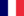

# Cosmetic tag modding

*Offline snapshot of the Hearts of Iron IV Wiki page "Cosmetic tag modding", revision 67378, captured 2026-10-31. Wiki text by the wiki's contributors under CC BY-SA 3.0 (see LICENSE.txt); kit blocks are local additions under the same license.*

<!-- kit:begin id="review" at="top" build="1.19.4.1" checked="2026-11-01" revision="67378" sources="common/countries/cosmetic.txt localisation/english/countries_cosmetic_l_english.yml gfx/flags/ common/names/ portraits/ gfx/entities/ common/autonomous_states/ common/on_actions/_documentation.md documentation/effects_documentation.md documentation/triggers_documentation.md" -->
**Kit review (HOI4 1.19.3.0, 2026-10-31).** Checked against: `common/countries/cosmetic.txt` (387 entries), the vanilla cosmetic localisation file (3,230 keys), `gfx/flags/`, `common/names/`, `portraits/`, `gfx/entities/`, every vanilla use of `set_cosmetic_tag` and `drop_cosmetic_tag`, and the effect, trigger and on action documentation.
Kit blocks added: scopes and vanilla use of the effects, flag file checks, `cosmetic.txt` format counts, localisation key shapes with counts, names, portraits and entities in vanilla.
Gaps left: how the game ranks competing flag and name variants, and the "one tag at a time" rule, are engine behaviour that script does not show. `COSMETICTAG` and `EUROPEAN_COSMETIC_TAG` are the wiki's placeholder names, not vanilla names. No vanilla entity is named after a cosmetic tag, so the entity example is unconfirmed.
**1.19.4.1 re-check (2026-11-01).** 6 tagged statements depended on files the update changed (`common/countries/cosmetic.txt`, `gfx/flags/`, the cosmetic localisation file, `common/names/00_names.txt` and the script folders that use the effects), and all of them were re-measured. `cosmetic.txt` has one more entry (388), one more cosmetic id has a group flag (197), the localisation key shapes grew (653 and 1,724 keys in the two largest) and `set_cosmetic_tag` is used 927 times in 178 files; the one new entry, `samanid_empire_tag`, has four group flags in `gfx/flags/`, and the tags without a flag file are still 115. Every other statement cites files that are byte-identical in 1.19.4.1 (Steam depot manifest diff).
<!-- kit:end id="review" -->

## Table of contents

- [Flag](#Flag)
- [Map colour](#Map_colour)
- [Localisation](#Localisation)
- [Other changes](#Other_changes)
- [Application](#Application)
- [Notes and references](#Notes_and_references)

---

Cosmetic tags are a feature used to change the cosmetic appearance of a country.

Unlike regular tags, cosmetic tags do not require any definition to work and are not limited to 3 letters. A cosmetic tag changes the cosmetic aspects of the country that has it. In debug mode, the name of the cosmetic tag is shown when hovering over the country's flag in the politics or diplomacy view. The country may only have at most one cosmetic tag, setting a new one will remove the previous one.

Most commonly, this is used to change the flag, name, and/or the colour of the country as it appears on the map, but it may also be used to change other information, such as the names and portraits of randomly-generated characters or entities used for the troop models. If a cosmetic tag doesn't change the appearance of a cosmetic aspect, it will remain unchanged from the default after the country gets it. The content for cosmetic tags is nearly always added identically to base cosmetic content, with the country tag replaced with the cosmetic tag.

## Flag <a id="Flag"></a>

*See also: [Country creation § Flag](<country_creation.md#Flag>)*

Flags are added in for cosmetic tags the same way as they would be added for the base appearance of countries: three 32-bit TGA-file flags with no RLE encoding with the bottom-left origin point are added into `/Hearts of Iron IV/gfx/flags` and its subfolders and their usage is based off the filename.

|  | Size requirement[1] | Resulting filesize`[a]` |
| --- | --- | --- |
| Standard | 82x52 pixels | 16.6 or 17.1 KiB |
| Medium | 41x26 pixels | 4.2 or 4.69 KiB |
| Small | 10x7 pixels | 324 or 819 bytes |

The name of the flag follows the same pattern as for regular flags: if ideology-specific, `COSMETICTAG_ideology.tga`, for the non-ideology fallback `COSMETICTAG.tga`. **The fallback does not have priority over an ideology-specific base country flag.** If the country TAG may choose between `TAG_ideology.tga` and `COSMETICTAG.tga`, it will use the former. Therefore, if the cosmetic tag should change the flag, adding ideology-specific flags for cosmetic tags is mandatory, unless the base country doesn't have ideology-specific flags itself.

<!-- kit:begin id="cosmetic-flag-vanilla" at="section:Flag" -->
**Kit note** Checks of the flag rules against `gfx/flags/`. All items: [vanilla-confirmed 1.19.4.1] `gfx/flags/`, `common/countries/cosmetic.txt`.

- The three sizes and the format hold: a sampled cosmetic flag (`RAJ_UK.tga`) is a 32-bit uncompressed TGA of 82x52 pixels in `gfx/flags/`, 41x26 in `gfx/flags/medium/` and 10x7 in `gfx/flags/small/`. The folders are only `medium` and `small`.
- File names follow `TAG.tga` and `TAG_<group>.tga` where `<group>` is one of `democratic`, `communism`, `fascism`, `neutrality` (for example `MAL_UK_democratic.tga`). Of the 387 distinct tags in `cosmetic.txt`, 91 have a plain `TAG.tga`, 197 have at least one group flag and 115 have no flag file at all, so they only change name, colour or the other cosmetic parts.
<!-- kit:end id="cosmetic-flag-vanilla" -->

## Map colour <a id="Map_colour"></a>

*See also: [Country creation § Country file](<country_creation.md#Country_file>)*

The map colours of a cosmetic tag, if they should change, are assigned in the `/Hearts of Iron IV/common/countries/cosmetic.txt` file. The file follows the exact same formatting as the `colors.txt` file used for regular tags:

```text
COSMETICTAG = {
    color = rgb { 2  10  222 }
    color_ui = rgb { 255 255 155 }
}
```

Either the RGB colour model or the HSV colour model may be used, signified by the `rgb`/`hsv` before the brackets. The RGB model may use decimals between 0 and 1 or between 0 and 255 for each value, while the HSV model must have its values limited to decimals between 0 and 1.

<!-- kit:begin id="cosmetic-colour-vanilla" at="section:Map_colour" -->
**Kit note** `common/countries/cosmetic.txt` has 388 entries (387 distinct ids; `SOV_ROME` is defined twice) and every one sets both `color` and `color_ui`. `color` is written with `rgb` in 386 entries and `hsv` in 2; `color_ui` with `rgb` in 387 and `hsv` in 1. An entry is optional: vanilla sets 191 cosmetic tag ids that have no entry in the file. [vanilla-confirmed 1.19.4.1] `common/countries/cosmetic.txt`, and every vanilla `set_cosmetic_tag` call.
<!-- kit:end id="cosmetic-colour-vanilla" -->

## Localisation <a id="Localisation"></a>

*See also: [Country creation § Localisation](<country_creation.md>)*

For the English language, the name of the country is created in any `/Hearts of Iron IV/localisation/english/*_l_english.yml` file encoded in UTF-8 with the byte order mark (or UTF-8-BOM). Either of the three versions of the name will overwrite the base country equivalent, for example:

```yaml
l_english:
 COSMETICTAG_neutrality: "Cosmetic tag"
 COSMETICTAG_neutrality_ADJ: "Cosmetic"
 COSMETICTAG_neutrality_DEF: "The cosmetic tag"
```

The cosmetic tag takes priority over the base localisation of the country. Each automatically-applying variation of the name may also be used, such as checking whether the country is a subject or if the check is moved to the ideology type within the ideology group, such as:

```yaml
l_english:
 COSMETICTAG_despotism_subject: "$OVERLORDADJ$ despotist cosmetic tag"
```

<!-- kit:begin id="cosmetic-localisation-vanilla" at="section:Localisation" -->
**Kit note** Key shapes in the vanilla cosmetic localisation file, `localisation/english/countries_cosmetic_l_english.yml` (UTF-8 with BOM, `l_english:` header). The file mixes cosmetic tags and ordinary country tags; the counts below cover only keys whose tag is a cosmetic id (an id from `cosmetic.txt` or one set by script that is not a plain 3-letter tag): 2,486 keys in the first four shapes below. Counts and examples: [vanilla-confirmed 1.19.4.1] `localisation/english/countries_cosmetic_l_english.yml`.

| Shape | Keys | Example |
| --- | --- | --- |
| `<TAG>`, `<TAG>_DEF`, `<TAG>_ADJ` | 653 | `INS_HOL`, `INS_HOL_DEF`, `INS_JAP_ADJ` |
| `<TAG>_<group>` with optional `_DEF` or `_ADJ` | 1,724 | `RAJ_UK_democratic`, `RAJ_UK_democratic_DEF` |
| `<TAG>_autonomy_<autonomy id>` with optional `_DEF` or `_ADJ` | 106 | `INS_HOL_autonomy_dominion`, `INS_HOL_autonomy_dominion_DEF` |
| `<TAG>_subject` | 3 | `RAJ_UK_subject` |
| `<TAG>_<group>_autonomy_<autonomy id>` with optional suffix | 12 | `UKR_SOV_communism_autonomy_dominion` |
| `<TAG>_<overlord tag>_<group>_subject` or `<TAG>_<overlord tag>_subject`, optional suffix | 34 | `turkestan_united_SOV_communism_subject`, `dalmatia_YUG_subject` |

- `<group>` is one of the four ideology groups (`democratic`, `communism`, `fascism`, `neutrality`). The file has no key that adds a sub-ideology type such as `despotism` to a cosmetic tag, so the wiki's `COSMETICTAG_despotism_subject` has no vanilla precedent. [vanilla-confirmed 1.19.4.1] `localisation/english/countries_cosmetic_l_english.yml`: of 3,242 keys, none has a type id of `common/ideologies/00_ideologies.txt` in the ideology slot. The only hits, `SPR_POR_anarchism_*` and `ARG_marxism`, are part of the cosmetic id.
- `<autonomy id>` is the `id` of an autonomy state in `common/autonomous_states/`, written with its `autonomy_` prefix, for example `autonomy_dominion` or `autonomy_puppet`.
- Cosmetic ids need not be 3 letters or upper case: the file has keys such as `turkestan_united_...` and `FRA_THIRD_EMPIRE_def`. 90 cosmetic keys end in a lower-case `_def` or `_adj` (for example `USA_wallis_simpson_neutrality_def`) next to the upper-case `_DEF` and `_ADJ` forms, and none of the 90 has an upper-case twin. [vanilla-confirmed 1.19.4.1] `localisation/english/countries_cosmetic_l_english.yml`. Write `_DEF` and `_ADJ` in upper case; whether the lower-case keys are read is not shown by script. [unverified]
- Keys can reuse others with `$KEY$`, for example `INS_HOL_FLAG_autonomy_dominion: "$INS_HOL_autonomy_dominion$"`, and use the tokens `$OVERLORDADJ$` (`RAJ_UK_subject: "$OVERLORDADJ$ Raj"`) and `$NONIDEOLOGY$`. `INS_HOL_FLAG` is a separate entry in `cosmetic.txt` with the same colours as `INS_HOL`, and its names point back to `INS_HOL`.
<!-- kit:end id="cosmetic-localisation-vanilla" -->

## Other changes <a id="Other_changes"></a>

Other than these main uses, cosmetic tags serve several more minor cosmetic changes.

- Randomly-generated names: A cosmetic tag may have its entry in `/Hearts of Iron IV/common/names` overwrite the entries used for the base country. This is used for randomly-generated character and idea (outside of the `country` category) names. This may be used to show that a different culture from usual dominates the government of the country. This is done in the exact same way as with a country tag:

```text
COSMETICTAG = {
    male = { names = { examplename } }
    female = { names = { examplename } }
    surnames = { examplesurname }
}
```

- Randomly-generated portraits: A cosmetic tag may have its entry in `/Hearts of Iron IV/portraits` overwrite the entries used for the base country. This is used for randomly-generated characters. This is done in the exact same way as with a country tag:

```text
EUROPEAN_COSMETIC_TAG = {
    army = { male = { "GFX_Portrait_Europe_Generic_land_1" } }
    navy = { male = { "GFX_Portrait_Europe_Generic_navy_1" } }
}
```

- Entities used for units: A cosmetic tag may have the [entities](<entity_modding.md>) used for its [units](<unit_modding.md>) be changed from the default in `/Hearts of Iron IV/gfx/entities/*.asset` files. This is done similarly to regular countries, by prepending the name of the cosmetic tag to the name of the entity, such as this entry that clones the  French artillery entity for the country with COSMETICTAG:

```text
entity = {
    name = "COSMETICTAG_artillery_entity"
    clone = "FRA_artillery_entity"
}
```

<!-- kit:begin id="cosmetic-other-vanilla" at="section:Other_changes" -->
**Kit note** What vanilla does with the three minor uses. The placeholder ids `COSMETICTAG` and `EUROPEAN_COSMETIC_TAG` are not vanilla names; use a real id. All items: [vanilla-confirmed 1.19.4.1] `common/names/00_names.txt`, `portraits/00_portraits.txt`, `portraits/998_scientist_portraits.txt`, `gfx/entities/`.

- Names: only `RAJ_UK` and `MAL_UK` have a cosmetic entry in `common/names/00_names.txt`.
- Portraits: `RAJ_UK`, `MAL_UK`, `INS_HOL` and `SAF_COM` have top-level entries in `portraits/00_portraits.txt` and in `portraits/998_scientist_portraits.txt`, next to the real tag entries (`GER`, `ENG`, ...). The file also has `default` and `continent` blocks.
- Entities: no `.asset` file in `gfx/entities/` defines an entity whose name starts with a cosmetic tag id, so the wiki's `COSMETICTAG_artillery_entity` pattern is not exercised by vanilla. [vanilla-confirmed 1.19.4.1] `gfx/entities/` (6,254 `name` values checked against all 388 ids in `common/countries/cosmetic.txt`). Whether the game uses such an entity is [unverified].
<!-- kit:end id="cosmetic-other-vanilla" -->

## Application <a id="Application"></a>

The cosmetic tag may be applied in any [effect](<effects.md>) block, and is limited to only being possible to add or remove via them. Effect blocks include but are not limited to focus rewards, event options, decision effects, and country history files.

`set_cosmetic_tag = COSMETICTAG` is used to apply the cosmetic tag to the country where the effect is executed. The tooltip will show that "Country will become known as the Cosmetic Tag", using the name of the country with the definite article (_DEF name, by the suffix in localisation) in the first part and the _DEF name of the cosmetic tag afterwards. If it appears in the tooltip that the name of the country doesn't change while the cosmetic tag is intended to, this is a sign that the _DEF name isn't defined. If the name shouldn't change, [it may be better to hide the tooltip from the player](<effects.md>) to avoid confusion.

`drop_cosmetic_tag = yes` is used to remove the cosmetic tag that the country currently has. It has no tooltip.

Example event that sets a cosmetic tag:

```text
country_event = {
    id = event.1
    title = event.1.t
    desc = event.1.desc

    is_triggered_only = yes

    option = {
        name = event.1.a
        set_cosmetic_tag = COSMETICTAG
    }
}
```

[On actions](<on_actions.md>) are commonly used to dynamically apply or remove cosmetic tags depending on the game circumstances, such as ideology change or puppeting (on actions are only able to detect puppeting in peace conferences and when releasing a country; [if puppeting is done via an effect](<effects.md>), then set_cosmetic_tag has to be in the same effect block that puppets the country).
An example on action that applies a cosmetic tag only when the country is non-aligned is as such:

```text
on_actions = {
    on_ruling_party_change = { # Note: the on action only runs after the game's start
        effect = {
            if = {
                limit = {
                    original_tag = ABC
                    has_government = neutrality
                }
                set_cosmetic_tag = ABC_neutrality
            }
            else_if = {
                limit = {
                    original_tag = ABC
                }
                drop_cosmetic_tag = yes
            }
        }
    }
}
```

<!-- kit:begin id="cosmetic-effects-vanilla" at="section:Application" -->
**Kit note** Scopes, forms and use of the cosmetic tag effects and trigger. Scope and syntax: [docs] `documentation/effects_documentation.md`, `documentation/triggers_documentation.md`. Counts: [vanilla-confirmed 1.19.4.1] over `common/`, `events/` and `history/`.

| Name | Kind | Scope | Vanilla form and use |
| --- | --- | --- | --- |
| `set_cosmetic_tag` | effect | COUNTRY, no targets | Always `set_cosmetic_tag = ID` (927 uses in 178 files, 560 different ids). |
| `drop_cosmetic_tag` | effect | COUNTRY, no targets | Always `drop_cosmetic_tag = yes` (252 uses in 71 files). The documentation example `INS = { drop_cosmetic_tag }` has no value; write `= yes` as vanilla does. |
| `has_cosmetic_tag` | trigger | COUNTRY | `has_cosmetic_tag = ID`. Almost all of its 87,057 uses are in scripted localisation. |

- Where `set_cosmetic_tag` appears: national focuses 281, events 202, scripted effects 142, decisions 144, on actions 132, `history/countries/` 24, and 2 inside an idea's effect block (`common/ideas/czechoslovakia.txt`), so country history files, idea effects and on actions all accept it.
- `on_ruling_party_change`, `on_government_change`, `on_puppet`, `on_release_as_puppet` and `on_subject_autonomy_level_change` are all listed in the on action documentation, so a cosmetic tag can be tied to an ideology change, a puppeting or a change of autonomy level. [docs] `common/on_actions/_documentation.md`
- Since it takes a bare id, the scope the effect runs in decides which country gets the tag; wrap it in `TAG = { set_cosmetic_tag = ID }` when you are not already in that country's scope. [docs] `documentation/effects_documentation.md`
- Of the ids vanilla sets, 191 are not listed in `common/countries/cosmetic.txt`, and 18 ids listed there are never set by vanilla script. [vanilla-confirmed 1.19.4.1] `common/countries/cosmetic.txt`.
<!-- kit:end id="cosmetic-effects-vanilla" -->

## Notes and references <a id="Notes_and_references"></a>

**^** **a:** If the correct settings of 32 bitdepth/bits per pixel and no RLE encoding are used, saving the flag should result in a consistent filesize each time. Paint.net, however, adds an approximately 500 byte large watermark to the end of the file if it is used to save the flag, which is not present when GIMP or Photoshop are used instead. The filesize is as shown in the Windows File Explorer and may differ in rounding if viewed elsewhere, such as the image editor's export menu.

1. ↑ `NDefines.NGraphics.COUNTRY_FLAG_TEX_WIDTH = 82`, `NDefines.NGraphics.COUNTRY_FLAG_TEX_HEIGHT = 52`, `NDefines.NGraphics.COUNTRY_FLAG_MEDIUM_TEX_WIDTH = 41`, `NDefines.NGraphics.COUNTRY_FLAG_MEDIUM_TEX_HEIGHT = 26`, `NDefines.NGraphics.COUNTRY_FLAG_SMALL_TEX_WIDTH = 10`, `NDefines.NGraphics.COUNTRY_FLAG_SMALL_TEX_HEIGHT = 7` in [Defines](<defines.md>)

---

## Navigation

**[Modding](<modding.md>)**

- **Documentation**: [Effects](<effects.md>) • [Triggers](<triggers.md>) • [Defines](<defines.md>) • [Modifiers](<modifiers.md>) • [List of modifiers](<list_of_modifiers.md>) • [Scopes](<scopes.md>) • [Localisation](<localisation.md>) • [On actions](<on_actions.md>) • [Data structures](<data_structures.md>) • [Flags](<data_structures.md#Flags>) • [Event targets](<data_structures.md#Event_targets>) • [Country tag aliases](<data_structures.md#Country_tag_aliases>) • [Variables](<data_structures.md#Variables>) • [Arrays](<data_structures.md#Arrays>)
- **Scripting**: [Achievements](<achievement_modding.md>) • [AI](<ai_modding.md>) • [AI focuses](<ai_focuses.md>) • [Autonomous states](<autonomy_state_modding.md>) • [Balances of power](<balance_of_power_modding.md>) • [Bookmarks/Scenarios](<bookmark_modding.md>) • [Game rules](<bookmark_modding.md#Game_rules>) • [Buildings](<building_modding.md>) • [Characters and traits](<character_modding.md>) • [Countries](<country_creation.md>) • [Divisions](<division_modding.md>) • [Decisions](<decision_modding.md>) • [Doctrines](<doctrine_modding.md>) • [Equipment](<equipment_modding.md>) • [Events](<event_modding.md>) • [Factions](<faction_modding.md>) • [Ideas](<idea_modding.md>) • [Ideologies](<ideology_modding.md>) • [Military industrial organizations](<military_industrial_organization_modding.md>) • [National focuses](<national_focus_modding.md>) • [Resources](<resources_modding.md>) • [Scripted GUI](<scripted_gui_modding.md>) • [Technologies and doctrines](<technology_modding.md>) • [Units](<unit_modding.md>)
- **Map**: [Map](<map_modding.md>) • [States](<state_modding.md>) • [Supply areas](<supply_areas_modding.md>) • [Strategic regions](<strategic_region_modding.md>)
- **Graphical**: [Interface](<interface_modding.md>) • [Graphical assets](<graphical_asset_modding.md>) • [Entities](<entity_modding.md>) • [Posteffects](<posteffect_modding.md>) • [Particles](<particle_modding.md>) • [Fonts](<font_modding.md>)
- **Cosmetic**: [Portraits](<portrait_modding.md>) • [Namelists](<namelist_modding.md>) • [Music](<music_modding.md>) • [Sound](<sound_modding.md>)
- **Other**: [Console commands](<console_commands.md>) • [Troubleshooting](<troubleshooting.md>) • [Mod structure](<mod_structure.md>) • [Mods](<mods.md>) • [Nudger](<nudger.md>)
- **Kit pages (not on the wiki)**: [Collection modding](<collection_modding.md>) • [Defines additions](<defines_additions.md>) • [Game rule modding](<game_rule_modding.md>) • [Intelligence operation modding](<intelligence_operation_modding.md>) • [Map mode modding](<map_mode_modding.md>) • [Occupation and resistance modding](<occupation_and_resistance_modding.md>) • [Peace conference modding](<peace_conference_modding.md>) • [Raid modding](<raid_modding.md>) • [Script constant modding](<script_constant_modding.md>) • [Special project modding](<special_project_modding.md>)
