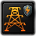

# State modding

States (and their history) are defined in `/Hearts of Iron IV/history/states/*.txt` files. While it is typical to reserve one file to a state, that is not necessary. Unlike, for example, `/Hearts of Iron IV/history/countries/`, **the filename does not get read in how the file should be handled**, only its contents do. For that reason, unless a [replace_path](modding.md) is defined to the folder, it should be avoided to change the filenames of already-existing files, as this can make it so that both the base game and the mod's state files will get read.

## Arguments

Each state is contained within a `state = { ... }` block that must encompass everything. These are the arguments that can be used.

### Mandatory

`id = 123` is the ID number of the state. It must be an integer.
**State IDs have to follow a numerical order,** starting from 1: the game will expect every number between 1 and the largest state ID within the mod to be a state. If that expectation is not met, the game will crash when loading the game if the [debug mode](modding.md) is not turned on, as the map is deemed too erroneous to be played normally.
As such, when deleting a state, the state IDs have to be shifted in order respectively, such as by changing the last state's ID to fit the now-missing ID. When doing that, everything that referenced the now-different state IDs will have to be adjusted, and [searching every text file in the mod using a text editor](modding.md) can be used to do so.

`name = STATE_123` is a localisation key that will become the name of the state, depending on which language is turned on. For English, this gets defined in any `/Hearts of Iron IV/localisation/english/*_l_english.yml` file as such:

```yaml
l_english:
 STATE_123: "My state name"
```

By default, the game uses `state_names_l_english.yml`.

`manpower = 500000` is the total population of the state at the game's start, both recruitable and non-recruitable. This will be the starting population on every scenario, without population growth being simulated between the first start date and the scenario's beginning. However, a single tick of monthly population growth will be done for each scenario, increasing the state's population by 0.125%.[1]

`state_category = my_category` is the category that the state uses. This sets the state modifiers that the state starts with (Including the amount of starting unlocked shared building slots), as well as assigning a colour to the state in the state view map mode. [Details on the state categories are covered later in the article.](#state-categories)

`provinces = { 123 456 7890 }` is the list of provinces that are defined as belonging to the state, separated with whitespace characters.

Ids and file names in 1.19.4.1.

- The ids are exactly 1 to 1081, each once, and every state has `name = "STATE_<id>"` (with the quotes). The English names are in `localisation/english/state_names_l_english.yml`.
- File names are irregular: 967 are `<id>-<name>.txt`, 113 are `<id> - <name>.txt` (spaces around the dash, for example `1014 - Bahrain.txt`) and one is `1013 -Musamdam.txt`. The wiki says the file name is not read, which fits these irregular names, so match files by the `id` inside, not by name.
- Every land province of `map/definition.csv` (10154 of them) is in exactly one state, no province is in two states, and 118 non-land provinces are listed in states too.
- Four files (`190-Kurzeme.txt`, `433-Rajputana.txt`, `440-West Punjab.txt`, `816-West Virginia.txt`) write `state_category` twice. Do not copy that.

`state_category` must name a category that exists in `common/state_category/`. The exe has the message " does not have a category defined." (in 1.19.4.1 no source file name `statetemplate.cpp` string is left next to it). `state_category = b8_missing` in `history/states/64-Brandenburg.txt` logged "State #64 does not have a category defined." at load, and at game start "64 - Brandenburg has too many buildings: -9". The message names the state by number, not the category, and the fallback category the game uses was not read. For the effect and trigger the exe has "Invalid category in set_state_category effect" and "Invalid category in has_state_category trigger". (unverified) Strings found in `hoi4.exe` only, not run. All 1081 vanilla states name one of the 13 vanilla categories; 11 files put the name in quotes (`state_category = "pastoral"`), so quotes are accepted.

State scope has `set_state_category = <category>` (effect) and `has_state_category = <category>` (trigger).

### Optional

`impassable = yes`, if added in the state, will mark it as impassable. This includes making troops unable to enter it; its provinces going to the controller of the nearest passable provinces; making it impossible to build provincial buildings within it; marking it as true for the [impassable trigger](triggers.md).

`resources = { steel = 10 aluminium = 20 }` assigns resources to the state. Each resource is added in the format of `<resource> = <int>`. Base game resources include `oil`, `aluminium` (With the spelling used in British English), `rubber`, `tungsten`, `steel`, and `chromium`, although more can be added.

`local_supplies = 8.3` decides the base supply of the state. One unit of local_supplies is equal to 0.2 units of supply. If undefined, assumed to be 0.

`buildings_max_level_factor = 0.5` adds an additional multiplier on the amount of unlocked shared building slots. Recommended to avoid, instead using state categories.

`impassable = yes` appears in 21 vanilla states, and all 21 also have `force_link_ownership_to = <state id>`, so the two always go together in vanilla.

```text
impassable = yes
force_link_ownership_to = 334 # Kalimantan
impassable_ignored_links = { 1024 } # Sabah
```

- `force_link_ownership_to` takes a state id: another, regional state (Kalimantan for Interior Borneo, Amazonas for most Deep Amazonas states). What exactly it links is not documented; the wiki says the provinces of an impassable state go to the controller of the nearest passable provinces. The exe prints "force_link_ownership_to is only effective when used on impassable states", and it does: `force_link_ownership_to = 10` on the passable state 64 logged that line at load and did nothing, as state 64 stayed with GER and not with the owner of state 10 (POL). The linking on an impassable state was not tested, so what it links rests on the wiki text. (unverified)
- `impassable_ignored_links = { <state id> ... }` is used once, in state 1022, and it is not documented anywhere in the game files.
- The 21 states are 19 `wasteland` and 2 `enclave`, categories that both have 0 building slots. 18 vanilla states write `infrastructure = 0`.
- Trigger `impassable` (state scope) checks the flag.

Base game resources in 1.19.3 are seven, not six: `oil`, `aluminium`, `rubber`, `tungsten`, `steel`, `chromium` and `coal`. See [Resources modding](resources_modding.md). 511 of 1081 vanilla state files have a `resources` block (`801-Moesia.txt` has one commented out).

`local_supplies` is in 1069 of 1081 vanilla states, with values from 0.0 to 16.0; 846 of them are 0.0. It replaces the supply area value (see [Supply areas modding](supply_areas_modding.md)). The wiki's "one unit equals 0.2 supply" is not stated in the game files. (unverified) for the 0.2 factor.

`buildings_max_level_factor` is set in 340 vanilla states (all `1.0`), although the wiki recommends avoiding it.

### History

All of these are contained within `history = { ... }`, which is defined within the state. Additionally, these can be used within a YYYY.MM.DD-formatted datestamp inside of history, such as `1939.1.1 = { ... }`. This will make them be executed only if the start date is strictly after the specified date.

`owner = POL` defines the initial owner of the state. If a state does not have an owner, the game will run without issues; however, executing nearly any effect on that state, such as transferring it to a country, will crash the game.

`controller = LIT` defines the initial controller of the state. Optional to define - only necessary if the owner differs from the controller.

`victory_points = { 1234 10 }` defines the amount of victory points on a specified province, where the first number is the province and the second number is the amount of victory points. **Only one province can be defined within one victory_points**. In order to have multiple provinces with victory points in one state, several instances of `victory_points = { ... }` need to be put in.
The localisation key that gets used for the victory point depending on the language of the game is `VICTORY_POINTS_1234`, where 1234 is the ID of the province. For English, this gets defined in any `/Hearts of Iron IV/localisation/english/*_l_english.yml` file as such:

```yaml
l_english:
 VICTORY_POINTS_1234: "My city name"
```

By default, the game uses `victory_points_l_english.yml`. For positioning the icon of a victory point on the map, the [unitstacks file](map_modding.md) is edited. Note that the icon of a victory point doesn't have to be inside of the province itself: if several victory points show up in the same place, it could be from different provinces with an outdated unitstacks file, which would need to be adjusted in the Nudge's Units section accordingly.

`buildings = { ... }` defines the initial buildings that the state has. A single building entry consists of the [the ID of the building](#building-types) followed by its amount after an equality sign as `dockyard = 10`. Within `buildings = { ... }`, it is also possible to specify a province by using `1234 = { ... }` and putting the province's buildings within, where 1234 is the province's ID. An example definition of buildings that uses this:

```text
buildings = {
    dockyard = 10
    1234 = {
        bunker = 5
        coastal_bunker = 6
    }
}
```

If a building is not mentioned, it does not change the initial value, which is 0 by default; however, the initial building level may be different if the buildings block is within a datestamp rather than being executed immediately. In landlocked states, buildings that can only be built on coastal states/provinces cannot be defined, even if set to 0.

Additionally, history serves as an [effect block](effects.md). Common effects to use within state history include `add_core_of = POL` or `add_claim_by = LIT`, but any effect can be used.

What 1.19.4.1 state history files contain, by key.

| Key inside `history = { }` | Files or uses |
| --- | --- |
| `owner` | 1081 (every state) |
| `buildings` | 1065 |
| `victory_points` | 1502 blocks |
| `add_core_of` | 1529 |
| `add_claim_by` | 43 |
| `strategic_province_location`, `strategic_state_location` | 16 and 8 (see below) |
| `add_dynamic_modifier`, `set_variable` | 21 and 23 |
| `set_compliance`, `set_resistance`, `start_resistance`, `set_demilitarized_zone` | 8, 7, 3 and 5 |
| `add_extra_state_shared_building_slots` | 2 |
| dated blocks such as `1939.1.1 = { }` | 13 distinct dates; `1939.1.1` is by far the most used (114 blocks) |
| `IF` / `if` blocks | 21; 78 files test `has_dlc` (most often "No Compromise, No Surrender") |

The wiki rule under History above, that a dated block runs only if the start date is strictly after its date, is wrong for the exact start moment. With the start at 1936.1.1.12 and `add_core_of = POL` in a dated block of state 64, the block dated `1936.1.1` ran, the one dated `1936.1.2` did not, and blocks dated `1936.1.1.12` (the exact start moment) and `1936.1.1.11` both ran, so a block runs when its date is the start date or earlier. The hour forms `.11` and `.12` were accepted without a date parse error. Core ownership was read with `is_core_of` in a probe, only one start date and one effect were tested.

A different controller is written inside a dated block (for example `controller = JAP` under `1938.10.25 = { }` in Suzhou) or with `set_province_controller`. 61 of the 62 `controller = TAG` lines in vanilla state files sit inside a dated block or an `if`; the one at history level is in `764-West Banat.txt`.

#### Setting owner and controller

Each pair has one effect per scope. The names differ by a `_to` suffix, and the argument is reversed.

| Effect | Scope | Argument | Vanilla uses |
| --- | --- | --- | --- |
| `set_state_owner = <state id>` | country | the state | 0 |
| `set_state_owner_to = <TAG>` | state | the new owner | 31 in 15 files |
| `set_state_controller = <state id>` | country | the state | 79 in 9 files |
| `set_state_controller_to = <TAG>` | state | the new controller | 92 in 17 files |
| `transfer_state = <state id>` | country | the state; sets owner and controller | 2279 in 154 files |
| `transfer_state_to = <TAG>` | state | the new owner; sets owner and controller | 811 in 97 files |

```text
GER = { transfer_state = 64 }
64 = { set_state_owner_to = GER }
```

The country-scope forms are the ones to read as "this country takes that state". Vanilla never uses `set_state_owner`, so prefer `transfer_state` or `set_state_owner_to`. Also in state scope: `add_core_of`, `add_claim_by`, `remove_core_of`, `remove_claim_by`, `set_state_name`, `reset_state_name`, `set_demilitarized_zone`, `set_compliance`, `set_resistance`, `set_state_province_controller` (all).

#### Strategic locations

A strategic location is a named bonus (or malus) to the maximum level of province buildings, defined in `common/strategic_locations/` and attached to a province from state history.

```text
natural_harbor = {
	naval_base = 2
}
```

Vanilla defines four, each +2 to one building: `natural_harbor` (naval_base), `defensive_chokepoint` (bunker), `defensible_coastline` (coastal_bunker) and `favorable_approach` (air_base). A negative number lowers the maximum level (the documentation example uses `naval_base = -2`).

Apply them in state scope. The effect names in the effects documentation are the ones vanilla uses: `strategic_province_location` for the province form and `strategic_state_location` for the state form.

```text
strategic_province_location = {
	defensible_coastline = 11932
}
strategic_state_location = {
	favorable_approach = 11932
}
```

Correction to the documentation file: it tells you to use an effect `strategic_location_building` and shows a `strategic_location = { }` wrapper. The effects documentation has no effect of that name; it lists `strategic_province_location` and `strategic_state_location`, although its own example text for the first still shows the old wrapper `strategic_location = { }`. No vanilla file uses `strategic_location_building` or `strategic_location`.

The right-hand number is a province id in both forms. The difference between the two effects is not explained in the game files; the docs call the first "add a strategic location to a province" and the second "add strategic locations to a state".

## Examples

Bare minimum:

```text
state = {
    id = 123
    name = STATE_123
    manpower = 50000
    state_category = large_town

    history = {
        owner = ITA
    }

    provinces = {
        1234 5678
    }
}
```

Average state:

```text
state = {
    id = 124
    name = STATE_124
    manpower = 50035
    state_category = megalopolis

    resources = {
        oil = 10
        chromium = 50
    }

    history = {
        owner = SWI
        add_core_of = SWI
        buildings = {
            infrastructure = 3
            industrial_complex = 1
            arms_factory = 1
            dockyard = 10
            7777 = {
                coastal_bunker = 5
                naval_base = 10
            }
        }
        victory_points = { 5555 15 }
        victory_points = { 6666 10 }
        1939.1.1 = {
            controller = ITA
            set_state_name = ITA_STATE_124
            buildings = {
                infrastructure = 4  # This will not change the amount of civilian or military factories.
            }
        }
    }

    provinces = { 1111 2222 3333 4444 5555 6666 7777 8888 9999 }

    local_supplies = 10
}
```

## Notes

`map/airports.txt` and `map/rocketsites.txt` do not exist in 1.19.4.1 (the Map modding page says they were removed in patch 1.15), so the second paragraph below no longer applies. The positions of air bases, rocket sites and gun emplacements are now rows in `map/buildings.txt` (ids `air_base`, `rocket_site_spawn`, `anti_air_building` and so on). The exe still prints map errors such as "no air base site defined for state" and "no rocket site defined for state", so a state that lacks those rows is still reported. With every row of state 64 removed from `map/buildings.txt` the game logged "MAP_ERROR: no air base site defined for state 64", "MAP_ERROR: no rocket site defined for state 64" and a third line, "MAP_ERROR: no gun emplacement defined for state 64", at game start, and a history error for the same state from `history/units/GER_1936_air_bba.txt` ("State 64 has no air base"). The mod file had 72 fewer lines than the unmodified one, so one line beyond the rows of state 64 may have gone as well.

The strategic region rule below holds in vanilla: none of the 1081 states has provinces in two strategic regions.

The building model positions for each state are defined separately from the states themselves, instead being defined in `/Hearts of Iron IV/map/buildings.txt`. A mismatch will cause errors, taking up space in the log and potentially crashes. For example, if a province is lacking a definition for a naval base or a floating harbour within a province, whether it's set in the wrong state in the buildings.txt file or missing entirely, **attempting to use one within that province (whether by the player or the AI) will cause a crash**, marked with [the last read script being client_ping](troubleshooting.md#crash-data-log). The simplest way to compile the positions of models is to use the building section in the [nudger](nudger.md).
`/Hearts of Iron IV/map/airports.txt` and `/Hearts of Iron IV/map/rocketsites.txt` decide in which province in the state the game should put airports or rocket sites. This is also edited in the building section in the [nudger](nudger.md). **If either is incorrect or missing, the game will not be possible to open without debug mode.**

The state borders must follow [strategic regions](strategic_region_modding.md), defined in `/Hearts of Iron IV/map/strategicregions/*.txt`. If one province in the state belongs to one strategic region, while a different province in the same state belongs to a different strategic region, a map error will be created, which will cause a game crash on launch if the debug mode is not turned on. Make sure that strategic region borders are followed, either by adjusting the state or the strategic regions.

## Using the nudger

*Parts of this section are transcluded from [Nudger § States](nudger.md#states)*

The [nudger](nudger.md) is a map editing tool, accessed through the main menu with the `-debug` launch option enabled. For the states, it can be used in order to change the borders of states and in order to generate the building models.

The state section of the nudger is used for defining the borders and names of states. Any state border changes will also automatically change the borders of the strategic regions that cover the states, taking provinces out of strategic regions completely for new states. Within the user directory, this edits the `/Hearts of Iron IV/history/states/` and `/Hearts of Iron IV/map/strategicregions/` folders and the `/Hearts of Iron IV/localisation/english/state_names_l_english.yml` file (for the English language).
**The nudger will remove quotation marks from the state file, aside from the `name` attribute.** This can break the rest of the script that's located inside of them. Most commonly, this will break any [has_dlc](triggers.md) checks, which will result in the entirety of the state breaking thereafter.
**The nudger interprets version number–less [localisation](localisation.md) values as having a version of -1**, and writes that in the output. As the game only expects numeric values in the version number, this will break the localisation after that point, with an error of the `Expected quotation mark (") at line 113 and column 16 in ...` sort.

Clicking onto a province is used to select a province. After a province is selected, `⇧Shift`-clicking onto a province causes the following behaviour, depending on the selected and clicked provinces:

- If the selected provinces are in a state and the shift-clicked province is in a different state or none at all, the game will adjust the borders of the state and the strategic regions to cover the shift-clicked province. It will also be selected.
  - If the shift-clicked province isn't in any state, it will be added to the state's strategic region without checking if it's already in one. **This may cause the province to be defined twice in the same strategic region or be defined in two different strategic regions.** This has to be fixed manually.
- If the selected provinces are in a state and the shift-clicked province is in the same state, it will be removed from the state and the strategic region without being selected. The same happens if the selected provinces aren't in any state.
- If the selected provinces and the shift-clicked province are both not in any state, it will get added to the selection.
- If the shift-clicked province is already selected, it will get removed from the selection and, if it's in one, the state it's currently in.

If a province or several not in any state are selected, it is possible to create a state. That requires entering a state name into the textbox and selecting "Create state".

- **The state name must only contain ASCII characters that are possible to use in filenames**. If there are any characters that aren't in ASCII, such as diacritics or non-Latin script, the game will crash to desktop instead of creating the state, but it will be able to remove the provinces from the old state first and save the changes there. Characters that are impossible to use in filenames include, on Windows, `\ / : * " < > |`.
- **Creating a new state (and occasionally editing state borders) requires changing the building model positions and airport/rocket launch site locations to avoid crashes**.

If the selected province(s) are in a state, it is possible to select "Open file" or "Delete state":

- Opening the file will use the default text editor for .txt files to open the file of the state in the user directory. If the user directory doesn't contain the file, a copy will be created. This copy doesn't contain the changes made in the nudger and instead will have those that were loaded into the memory when the files were last fetched (by opening the game, with "Update", or with "Save"). If the button is used and the file's version in the user directory is deleted, the button will do nothing until the next fetch of state files.
- "Delete state" will not necessarily delete the state, but instead remove the file from the user directory (if it exists) and unload from memory all changes that were made to it in the nudger. This will also cause the game to try reading the state files related to the state ID: if the [loaded files](modding.md#loading-files) contain a state with the same ID, it will get used for the state's information, otherwise it will be deleted.

Among the buttons that can always be selected, there are "Delete all empty" and "Find collision".

- "Delete all empty" works similarly to deleting an individual state: it checks for all provinces that have no provinces in memory (taking unsaved changes into consideration). If it finds any, the state gets deleted from memory and the user directory. Afterwards, the game will try finding a file to use as the new state information for each of the deleted states.
- "Find collision" detects provinces that are located in several states at the same time. When pressed, it will move the player's camera to one of such provinces and give a selection of which state it must remain in; upon making a choice, it will be removed from every other state.

"Update" is used to disregard all unsaved changes and re-read the state files among the [loaded files](modding.md#loading-files). If the state borders were manually changed, such as by moving the outputs into the mod files from the user directory, this is necessary to load them without restarting the game.
"Save" is used to write all changes to the user directory. Upon doing so, the changes will be purged from memory and the game will re-read the state files among the [loaded files](modding.md#loading-files). **If the state files in the user directory are overwritten or unloaded by mod files, it will appear that (some of) the changes will instantly revert, however they'll still be present in the user directory.** This will require moving the files into the mod's files and updating the state of the game with "Update". Only the files since the last fetching of files will be created or changed within the user directory after saving.

### Buildings

\*Please help improve this article or section by expanding it .\*

What state history gives a state at start, from the 1081 vanilla files.

State-level entries (written directly in `buildings = { }`; the number is how many times the key is written, and the highest level used):

| Key | Entries | Highest level |
| --- | --- | --- |
| `infrastructure` | 1069 | 5 |
| `industrial_complex` | 531 | 11 |
| `air_base` | 353 | 10 |
| `arms_factory` | 257 | 10 |
| `dockyard` | 110 | 8 |
| `anti_air_building` | 18 | 5 |
| `fuel_silo` | 15 | 1 |
| `synthetic_refinery` | 9 | 3 |
| `radar_station` | 7 | 1 |

Province-level entries sit in a nested block `<province id> = { ... }` inside `buildings` (counts are entries): `naval_base` (536), `coastal_bunker` (59), `bunker` (55), `dam` (15), `naval_headquarters` (9), `naval_supply_hub` (8), `naval_facility` (8), `land_facility` (4), `air_facility` (4), one `dam_mountain`, and 21 `landmark_*` entries of 17 kinds (5 of them `landmark_great_wall_section`). `supply_node` and `rail_way` never appear in state history; they start from `map/supply_nodes.txt` and `map/railways.txt`.

```text
buildings = {
	infrastructure = 2
	air_base = 3
	11932 = {
		naval_base = 3
	}
}
```

- 117 `buildings` blocks sit inside a dated block or an `if` / `IF`, which is how the 1936 and 1939 starts differ. The numbers in a dated block are the new total level, not an addition (the wiki example shows `infrastructure = 4` in a `1939.1.1` block). (unverified) for the "total, not addition" reading; the wiki states it and vanilla is consistent with it.
- A level of 0 is legal: 18 states write `infrastructure = 0`.
- The wiki's rule that coastal-only buildings cannot be set in landlocked states matches `only_costal = yes` in `common/buildings/`, which `naval_facility`, `naval_base`, `coastal_bunker`, `dockyard`, `naval_supply_hub` and `naval_headquarters` carry.
- Positions of the models are not in the state file. `map/buildings.txt` has one row per model (66664 rows in vanilla, 22 distinct ids); see [Map modding](map_modding.md#buildings).

## Building types

*Main article: [Building modding](building_modding.md)*

These are the different types of buildings in the game (Can also be found inside `/Hearts of Iron IV/common/buildings/00_buildings.txt`):

| Icon | Localised name | Internal name | Maximum level | Type |
| --- | --- | --- | --- | --- |
|  | Infrastructure | infrastructure | 5 | Non-shared |
|  | Military factory | arms_factory | 20 | Shared |
|  | Civilian factory | industrial_complex | 20 | Shared |
|  | Air base | air_base | 10 | Non-shared |
|  | Supply hub | supply_node | 1 | Provincial |
|  | Railway | rail_way | 5[2] | Provincial |
|  | Naval Engineering Facility | naval_facility | 1 | Provincial |
|  | Naval base | naval_base | 10 | Provincial |
|  | Land fort | bunker | 10 | Provincial |
|  | Coastal fort | coastal_bunker | 10 | Provincial |
|  | Stronghold Network | stronghold_network | 1 | Shared |
|  | Naval dockyard | dockyard | 20 | Shared |
|  | Anti-air | anti_air_building | 5 | Non-shared |
|  | Synthetic refinery | synthetic_refinery | 3 | Shared |
|  | Fuel silo | fuel_silo | 15 | Shared |
|  | Radar station | radar_station | 6 | Non-shared |
|  | Multi-Charge Large Caliber Gun(\*) | mega_gun_emplacement | 1 | Shared |
|  | Rocket site(\*) | rocket_site | 3 | Shared |
|  | Naval supply hub (\*) | naval_supply_hub | 1 | Provincial |
|  | Naval headquarters (\*) | naval_headquarters | 1 | Provincial |
|  | Nuclear reactor | nuclear_reactor | 1 | Shared |
|  | Heavy Water Nuclear Reactor | nuclear_reactor_heavy_water | 1 | Shared |
|  | Civilian Nuclear Reactor | commercial_nuclear_reactor | 1 | Shared |
|  | Nuclear Research Facility | nuclear_facility | 1 | Provincial |
|  | Aerodynamics and Avionics Facility | air_facility | 1 | Provincial |
|  | Land Warfare Facility | land_facility | 1 | Provincial |
|  | Dam | dam | 1 | Provincial |
|  | Dam | dam_mountain | 1 | Provincial |
|  | Kiel Canal Locks | canal_kiel | 1 | Provincial |
|  | Panama Canal Locks | canal_panama | 1 | Provincial |
|  | Reinforced electrical grid(\*) | energy_infrastructure | 1 | Shared |
|  | High capacity electrical grid(\*) | industrial_infrastructure | 1 | Shared |

Note that while railways and supply nodes are buildings, not all traditional building operations apply to them. Their starting level is defined [outside of state history](map_modding.md) and [a separate effect](effects.md) must be used to construct railways mid-game, with the default [add_building_construction](effects.md) or other building-related effects crashing the game.

The table is incomplete for 1.19.3. `common/buildings/` defines 55 buildings, not 32: the table lacks `cataract_dam_mountain` and 22 `landmark_*` buildings. The full list with level caps and flags is on [Building modding](building_modding.md#types).

The closing note is partly wrong for supply hubs. Vanilla script builds them with `add_building_construction = { type = supply_node province = <id> level = 1 instant_build = yes }` (72 blocks in 21 files), so the effect does not crash for `supply_node`. No vanilla file builds `rail_way` that way; railways go through `build_railway`.

## State categories

The base game state categories and their corresponding number of building slots:

| Localised name | Internal name | Amount of slots | Color |
| --- | --- | --- | --- |
| Wasteland | wasteland | 0 |  |
| Enclave | enclave | 0 |  |
| Tiny island | tiny_island | 0 |  |
| Pastoral region | pastoral | 1 |  |
| Small island | small_island | 1 |  |
| Rural region | rural | 2 |  |
| Developed Rural Region | town | 4 |  |
| Sparse Urban Region | large_town | 5 |  |
| Urban Region | city | 6 |  |
| Dense Urban Region | large_city | 8 |  |
| Metropolis Region | metropolis | 10 |  |
| Megalopolis Region | megalopolis | 12 |  |

State categories can be added in `/Hearts of Iron IV/common/state_category/*.txt` files. Each state category is contained within the `state_categories = { ... }`, as a code block with the name of the state category's ID.

A state category is a [modifier block](modifiers.md#state-scope), where any state-scoped modifier can be used. The only modifier that the base game uses is `local_building_slots`, set to an integer, but any can be used. Additionally, the `color = { 0 0 255 }` block corresponds to the state's colour in the state map mode. It is defined in the RGB format, where each value is an integer on the scale from 0 to 255.

Example:

```text
state_categories={
    my_state_category = {
        color = { 0 255 0 }
        local_building_slots = 14
    }
    my_second_category = {
        color = { 255 0 0 }
        local_building_slots = 4
        resistance_growth = 0.1
    }
}
```

The `set_state_category = category_id` effect can be used to change the state category of a state mid-game.

1. `NDefines.NCountry.POPULATION_YEARLY_GROWTH_BASE = 0.015`
2. `NDefines.NSupply.MAX_RAILWAY_LEVEL = 5` in [Defines](defines.md).

Vanilla 1.19.3 has 13 categories (one file each in `common/state_category/`), not 12. The table above lacks `large_island`. The "only modifier" claim is also out of date: the island categories use a `buildings_max_level` block.

| Internal name | Slots (`local_building_slots`) | `color` | Extra |
| --- | --- | --- | --- |
| `wasteland` | 0 | 40 40 40 | |
| `enclave` | 0 | 40 40 40 | |
| `tiny_island` | 0 | 40 40 40 | `buildings_max_level = { naval_base = 3 air_base = 2 }` |
| `pastoral` | 1 | 160 160 0 | |
| `small_island` | 1 | 200 160 0 | `buildings_max_level = { naval_base = 6 air_base = 4 }` |
| `large_island` | 3 | 200 160 0 | `buildings_max_level = { naval_base = 8 air_base = 6 }` |
| `rural` | 2 | 240 160 0 | |
| `town` | 4 | 200 200 0 | |
| `large_town` | 5 | 240 240 0 | |
| `city` | 6 | 0 200 0 | |
| `large_city` | 8 | 0 240 0 | |
| `metropolis` | 10 | 0 200 200 | |
| `megalopolis` | 12 | 0 240 240 | |

Each file is `state_categories = { <name> = { local_building_slots = N color = { r g b } } }`. Vanilla localises every category twice: plain keys such as `town: "Developed Rural Region"` (the names in the wiki table) and `STATE_CATEGORY_<name>` keys with shorter names such as `STATE_CATEGORY_town: "Town"`.
