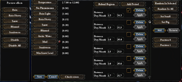

# Nudger

*Offline snapshot of the Hearts of Iron IV Wiki page "Nudger", revision 97432, captured 2026-10-31. Wiki text by the wiki's contributors under CC BY-SA 3.0 (see LICENSE.txt); kit blocks are local additions under the same license.*

<!-- kit:begin id="review" at="top" build="1.19.3.0" checked="2026-10-31" revision="97432" sources="interface/nudge.gui interface/nudge.gfx interface/frontendmainview.gui map/buildings.txt map/unitstacks.txt map/supply_nodes.txt map/railways.txt map/weatherpositions.txt map/definition.csv map/strategicregions/ history/states/ buildings_nudger_markers.txt unit_nudger_markers.txt common/defines/00_graphics.lua documentation/console_commands_documentation.md" -->
**Kit review (HOI4 1.19.3.0, 2026-10-31).** Checked against: the nudger's own interface file `interface/nudge.gui` (every window and button label), `interface/frontendmainview.gui`, the map files the nudger reads and writes (row counts and column layout of `map/buildings.txt` and `map/unitstacks.txt`, sizes of the others), the two marker files in the game folder, the nudger define, the `nudge` console command, and class names in `hoi4.exe`.
Kit blocks added: the nudger menu in 1.19.3, the filled "Strategic regions", "Buildings", "Units" and "References and notes" sections, a folder name correction in "Weather".
Gaps left: the wiki's long behaviour descriptions (shift-click rules, save and update semantics, crash causes) cannot be checked from game files and are left as written. What the "Mark/Unmark", "Random" and "Validate" buttons do exactly, and what the marker files hold, is not documented, so those statements are marked `[unverified]`.
<!-- kit:end id="review" -->

## Table of contents

- [Overview](#Overview)
- [States](#States)
  - [Buildings](#Buildings)
- [Strategic regions](#Strategic_regions)
  - [Weather](#Weather)
    - [Weather positions](#Weather_positions)
    - [Weather chances](#Weather_chances)
- [Database](#Database)
- [Units](#Units)
- [Supply](#Supply)
- [References and notes](#References_and_notes)

---

The nudger is a tool in Hearts of Iron IV used in creation of map-related files.

The nudger is accessed via the [nudge console command](<console-commands.md>) or the "Nudge!" button in the main menu, which appears when the [debug launch option](<modding.md>) is used when launching the game. Upon launching, it will show the default state of the world, as it appears in the [bookmark](<bookmark-modding.md>) that's set to be the default. If there is no default bookmark, then the map will appear as having no countries.

The nudger will always output the files directly into the [user directory](<modding.md>), such as `C:/Users/username/Documents/Paradox Interactive/Hearts of Iron IV/` (the default location on Windows without OneDrive). **Unless moved, the generated files will be loaded when opening the base game**, potentially causing crashes and at the very least map definition errors that cause the game to close itself without the debug mode. This potentially includes the `history/states/`, `map/`, and `localisation/english/`.

## Overview 

- States: Used to edit the state history files. It doesn't modify the state-wide building model positions, necessary for a new state to work as intended.
- Supply areas: The supply areas were removed in 1.11 (the update with the No Step Back DLC), and the button is currently non-functional.
- Strategic regions: Edits the strategic region borders and, for naval regions, terrain and modifiers.
- Ambient objects: Edits the 3D models rendered consistently on the world's map, most notably the borders on the North and the South.
- Database: Edits the `/Hearts of Iron IV/map/definition.csv` file, used for province information.
- Weather: Edits the weather within strategic regions and the position of meshes used for the weather effects.
- Buildings: Used for positioning building models, assigning the neighbouring sea province for naval bases and floating harbours, and for assigning each state a single province where the air base and the rocket launch base are located. **Will cause crashes if a new state is created without that being adjusted.**
- Units: Used for establishing the exact position of unit models and victory points.
- Supply: Used for positioning the starting locations and levels of supply hubs and railways.
- Leave nudge: Attempts to return to the main menu. If the nudger was entered using the console instead of the main menu, results in a crash to desktop.

<!-- kit:begin id="nudger-menu" at="section:Overview" -->
**Kit note** The nudger menu as 1.19.3 defines it. The selection window is headed "Choose nudger" and lists, in this order: States, Supply Areas, Strategic Regions, Ambient objects, Database, Weather, Buildings, Units, Supply, and a "Leave Nudge" button. The main menu button is `nudge_button`, labelled "Nudge!". [vanilla-confirmed 1.19.3] `interface/nudge.gui`, `interface/frontendmainview.gui`

The console command `nudge` is documented as "Go to the nudge tool". [docs] `documentation/console_commands_documentation.md`

"Supply Areas" is still in the menu and `nudge_window_supplyarea` is still in the interface file (fields "Supply area name" and "Base value", buttons "Apply value", "Generate", "Regenerate All", "Open File", "Delete region", "Create region", "Update", "Save"). `hoi4.exe` has nudger classes for states, strategic regions, ambient objects, the database, weather, buildings, units and supply hubs, and none for supply areas, which fits the page's remark that the button does nothing. [vanilla-confirmed 1.19.3] `interface/nudge.gui`. The class list is [unverified] `hoi4.exe`

The game's own map error text tells the player: "You can still access the Nudger to attempt to fix the issues", and after coming back from it, restart the game so everything reloads. [vanilla-confirmed 1.19.3] `localisation/english/core_l_english.yml` (`MAP_LOADING_ERROR_INGAME_MITIGATION`)
<!-- kit:end id="nudger-menu" -->

## States 

*See also: [State modding](<state-modding.md>)*

The state section of the nudger is used for defining the borders and names of states. Any state border changes will also automatically change the borders of the strategic regions that cover the states, taking provinces out of strategic regions completely for new states. Within the user directory, this edits the `/Hearts of Iron IV/history/states/` and `/Hearts of Iron IV/map/strategicregions/` folders and the `/Hearts of Iron IV/localisation/english/state_names_l_english.yml` file (for the English language).
**The nudger will remove quotation marks from the state file, aside from the `name` attribute.** This can break the rest of the script that's located inside of them. Most commonly, this will break any [has_dlc](<triggers.md>) checks, which will result in the entirety of the state breaking thereafter.
**The nudger interprets version number–less [localisation](<localisation.md>) values as having a version of -1**, and writes that in the output. As the game only expects numeric values in the version number, this will break the localisation after that point, with an error of the `Expected quotation mark (") at line 113 and column 16 in ...` sort.

Clicking onto a province is used to select a province. After a province is selected, `⇧Shift`-clicking onto a province causes the following behaviour, depending on the selected and clicked provinces:

- If the selected provinces are in a state and the shift-clicked province is in a different state or none at all, the game will adjust the borders of the state and the strategic regions to cover the shift-clicked province. It will also be selected.
  - If the shift-clicked province isn't in any state, it will be added to the state's strategic region without checking if it's already in one. **This may cause the province to be defined twice in the same strategic region or be defined in two different strategic regions.** This has to be fixed manually.
- If the selected provinces are in a state and the shift-clicked province is in the same state, it will be removed from the state and the strategic region without being selected. The same happens if the selected provinces aren't in any state.
- If the selected provinces and the shift-clicked province are both not in any state, it will get added to the selection.
- If the shift-clicked province is already selected, it will get removed from the selection and, if it's in one, the state it's currently in.

If a province or several not in any state are selected, it is possible to create a state. That requires entering a state name into the textbox and selecting "Create state".

- **The state name must only contain ASCII characters that are possible to use in filenames**. If there are any characters that aren't in ASCII, such as diacritics or non-Latin script, the game will crash to desktop instead of creating the state, but it will be able to remove the provinces from the old state first and save the changes there. Characters that are impossible to use in filenames include, on Windows, `\ / : * " < > |`.
- **Creating a new state (and occasionally editing state borders) requires changing the building model positions and airport/rocket launch site locations to avoid crashes**.

If the selected province(s) are in a state, it is possible to select "Open file" or "Delete state":

- Opening the file will use the default text editor for .txt files to open the file of the state in the user directory. If the user directory doesn't contain the file, a copy will be created. This copy doesn't contain the changes made in the nudger and instead will have those that were loaded into the memory when the files were last fetched (by opening the game, with "Update", or with "Save"). If the button is used and the file's version in the user directory is deleted, the button will do nothing until the next fetch of state files.
- "Delete state" will not necessarily delete the state, but instead remove the file from the user directory (if it exists) and unload from memory all changes that were made to it in the nudger. This will also cause the game to try reading the state files related to the state ID: if the [loaded files](<modding.md#Loading_files>) contain a state with the same ID, it will get used for the state's information, otherwise it will be deleted.

Among the buttons that can always be selected, there are "Delete all empty" and "Find collision".

- "Delete all empty" works similarly to deleting an individual state: it checks for all provinces that have no provinces in memory (taking unsaved changes into consideration). If it finds any, the state gets deleted from memory and the user directory. Afterwards, the game will try finding a file to use as the new state information for each of the deleted states.
- "Find collision" detects provinces that are located in several states at the same time. When pressed, it will move the player's camera to one of such provinces and give a selection of which state it must remain in; upon making a choice, it will be removed from every other state.

"Update" is used to disregard all unsaved changes and re-read the state files among the [loaded files](<modding.md#Loading_files>). If the state borders were manually changed, such as by moving the outputs into the mod files from the user directory, this is necessary to load them without restarting the game.
"Save" is used to write all changes to the user directory. Upon doing so, the changes will be purged from memory and the game will re-read the state files among the [loaded files](<modding.md#Loading_files>). **If the state files in the user directory are overwritten or unloaded by mod files, it will appear that (some of) the changes will instantly revert, however they'll still be present in the user directory.** This will require moving the files into the mod's files and updating the state of the game with "Update". Only the files since the last fetching of files will be created or changed within the user directory after saving.

### Buildings 

\*Please help improve this article or section by expanding it .\*

<!-- kit:begin id="nudger-buildings" at="section:Buildings" -->
**Kit addition** The Buildings section writes `map/buildings.txt` (to the user directory, like the other sections). The row layout is `state id;building id;x;y;z;rotation;sea province` and is explained on [Map modding](<map-modding.md#Buildings>) and [Building modding](<building-modding.md#Models>). The output path is inferred from the file names in the exe. [unverified] `hoi4.exe`

What a correct vanilla file looks like, to check a nudged file against. All rows: [vanilla-confirmed 1.19.3] `map/buildings.txt`.

- 66664 rows, each with exactly 7 `;` separated columns, LF line ends, no final newline, coordinates with 2 decimals.
- State ids run from 1 to 1081 and every one of the 1081 files in `history/states/` has rows.
- Every state has exactly 1 `air_base`, 1 `rocket_site_spawn`, 1 `nuclear_reactor_spawn`, 1 `synthetic_refinery`, 1 `fuel_silo`, 1 `radar_station` and 1 `stronghold_network` row, 3 `anti_air_building` rows, 6 `arms_factory` rows and 6 `industrial_complex` rows.
- The last column is non-zero in all 4696 `naval_base_spawn` and `floating_harbor` rows and 0 in all other rows.
- The page's overview says each state needs one province for the air base and the rocket site. The 1081 single `air_base` and `rocket_site_spawn` rows are the data behind that.
- The page warns that a new state without these rows crashes the game. Why it crashes is not stated in any game file. [unverified] `map/buildings.txt`

The window `nudge_window_buildings` has these controls. All rows: [vanilla-confirmed 1.19.3] `interface/nudge.gui`.

| Control | Label or key |
| --- | --- |
| Check boxes | "Show state only", "Show type only" |
| Lists | `templates_list` (building types), `instances_list` (placed instances) |
| Buttons | "Add", "Remove", "Clear state", "Remove All", "Open file" |
| Positioning | "Random In State", "Random All States", "Random All Unmarked" |
| Checking | "Validate In State" (key `v`), "Validate All States", "Find Error" (key `f`) |
| Marking | "Mark/Unmark" (key `m`) |
| Output | "Save", "Cancel" |
| Text boxes | `hints` and `message`, filled in by the game at run time |

What the buttons do is read from their labels; no game file describes them. In particular "Random" probably places models and "Validate" probably checks the rows against rules like the list above. [unverified] `interface/nudge.gui`

The define `DEFAULT_NUDGE_FLOATING_HARBOR_DIST = 7.0` is the default distance of a floating harbor from the coast in pixels, "for nudger". [vanilla-confirmed 1.19.3] `common/defines/00_graphics.lua`

The game folder holds `buildings_nudger_markers.txt` (874 bytes). Every byte is NUL (0x00), so it is not a readable text file; its name is also a string in `hoi4.exe`. It probably stores the marks set with "Mark/Unmark", but no game file says so. [vanilla-confirmed 1.19.3] `buildings_nudger_markers.txt`. The purpose is [unverified] `hoi4.exe`
<!-- kit:end id="nudger-buildings" -->

## Strategic regions 

\*Please help improve this article or section by expanding it .\*

<!-- kit:begin id="nudger-strategic-regions" at="section:Strategic_regions" -->
**Kit addition** The strategic region window in `interface/nudge.gui`. All rows: [vanilla-confirmed 1.19.3] `interface/nudge.gui`.

| Part | Controls |
| --- | --- |
| Header | text "Strategic region name:" and a name box |
| File buttons | "Open File", "Delete region", "Create region", "Update", "Save" |
| Modifiers panel | heading "Modifiers", boxes "Name" and "Trigger", buttons "Update" and "Delete", a list of the region's modifiers |
| Naval Terrains panel | heading "Naval Terrains", ten buttons: the first is labelled "Default"; the other nine are all labelled "Supply Areas" in the file, which looks like a copy-paste placeholder |

The panels line up with the page's overview line "Edits the strategic region borders and, for naval regions, terrain and modifiers". What each button does is read from its label only. [unverified] `interface/nudge.gui`

Vanilla has 304 strategic region files in `map/strategicregions/` (for example `1-Southern England.txt`). Their format is on [Map modding](<map-modding.md#Strategic_regions>) and [Strategic region modding](<strategic-region-modding.md>). [vanilla-confirmed 1.19.3] `map/strategicregions/`
<!-- kit:end id="nudger-strategic-regions" -->

### Weather 

*See also: [Map modding § Weather](<map-modding.md#Weather>)*

Instruments in the Weather section

*Instruments in the Weather section*

The weather section of the nudger is used for deciding the chance for weather-related province modifiers during a time period in strategic regions and for determining the positions of particle spawners for weather effects. This edits `/Hearts of Iron IV/map/strategic_regions/` and `/Hearts of Iron IV/map/weatherpositions.txt`.

The weather instruments can be split into 4 general groups: previewing effects on the far left (as a separate window), weather chances on the left, period selection on the right, and weather position modifying on the far right. For the weather positions, the previewing effects on the far left and weather position modifying on the far right are used; for modifying the chances of province modifiers, the weather chances on the left and period selection on the right are used.

Weather can only be modified with a strategic region selected. When a region is selected, yellow gizmos representing the weather positions will be shown on the map, with the text "small" or "big" representing the volume of the generated particles.

"Save" in the bottom left will output all of the changes to the user directory, "Cancel" will purge all of the changes from memory, while "Reload regions" in the top left will purge the changes from memory and re-read the strategic region and weather position files.

<!-- kit:begin id="nudger-weather-correction" at="section:Weather" -->
**Kit correction** The text above names `/Hearts of Iron IV/map/strategic_regions/`. The vanilla folder is `map/strategicregions/` without an underscore, as the States section writes it. [vanilla-confirmed 1.19.3] `map/strategicregions/`

`map/weatherpositions.txt` has one row per weather position: `region id;x;y;z;size`, with `size` either `small` or `big`. Vanilla has 588 rows over 287 regions (452 `big`, 136 `small`), for example `1;2781.24;9.90;1571.49;small`. [vanilla-confirmed 1.19.3] `map/weatherpositions.txt`. The first column is probably the strategic region id, the number at the start of the region's file name. [unverified] `map/weatherpositions.txt`
<!-- kit:end id="nudger-weather-correction" -->

#### Weather positions 

The menu on the far right is used for the positions of weather-related particle effects, in particular these buttons are used:

- "Random In Selected", once selected, will randomly change the locations of the existing weather positions to be evenly distributed in the area of the strategic region. This will not change the amount of weather positions nor their sizes. However, if the strategic region lacks any weather positions, the nudger will create 2 big weather positions first.
- "Random In All" will randomise every strategic region's weather positions using the same process as above.
- "Add" is used for creating a new weather position. Upon creation, it will be centered in the province of the strategic region that has the smallest province ID.
- The list of weather positions below allows selecting a single weather position. Upon one being selected, the map will change to highlight the selected weather position in red and hide all other positions. Right clicking on a location will allow to move the weather position there.
- "Set Small" and "Set Big" change the volume of particles emitted by the weather position. If a weather position is selected, then only it will change in size. Otherwise, every weather position in the selected strategic region will change in size.
- "Remove" is used for deleting a weather position from the region.

The "Preview effects" is used for previewing how the particle effects will look like in-game. Only one weather effect can be selected in a strategic region at a time, however they can be played over multiple strategic regions at the same time. **Enabling weather in the graphics settings is mandatory for this to have effect**. Selecting an effect will show the particles associated with it generated by the weather positions. "Disable" is used for removing the particle effects from the currently-selected strategic region, while "Disable All" removes the effect from every single strategic region.

#### Weather chances 

The weather chances are decided by the time periods. On the right, a list of periods is given, and "Add Period" will create a new one in the list. The checkbox in the top-right will select the current weather period, while "Delete" will remove it from existence. "Between Day.Month" is used for applying the time during which the time period should apply, in the Day.Month format. Both begin with 1 as the first day or month, and the range includes both ends. "Apply" is used to set the changes to the period's length, as they will otherwise reset upon creating a new period and will not save.
**Periods in the nudger aren't region-specific**: editing the lengths of periods and adding/removing them will result in changes for every single strategic region. "Check errors" in the bottom left is used for checking the period-related errors, such as there being days covered by no periods or several of them at once.

The menu on the left allows changing the temperature range and the chances for each of the weather modifiers. For editing this, a strategic region and a period must be selected. Most of these are sliders allowing to set a value between 0 and 1, including both ends. There are the following exceptions:

- "Temperature" is the temperature range of the region. This allows setting a minimum and maximum temperature as separate ranges. Very cold or hot temperatures will modify the combat with the ranges listed in Weather § Temperature.
- The button next to "Mud" allows instantly changing the chance of Arctic Water to either 1.00 or 0.00. This is generally useful for setting a lot of sea strategic regions to be always frozen in a certain period.

## Database 

*See also: Province modding*

The database section of the nudger is used for editing the `/Hearts of Iron IV/map/definition.csv` file used for province definitions. Within the user directory, this edits the `/Hearts of Iron IV/map/definition.csv.cache` and `/Hearts of Iron IV/map/definition.csv.fixed.csv` file. Despite the different name, the "fixed" province definition will still get read and have priority over `definition.csv`.

**Most of the buttons of the database section are likely to crash the game if no playthrough has yet started.** It is advisable to start a new game, go through the process of selecting a country and starting a playthrough, exit to the main menu, and access the nudger from there. Using the console command works to avoid the crash, but will cause a game crash when trying to leave the nudger.
Most of the selectable buttons change the appearance of the world map in a certain way. However, after changing once, the world map stays static, without registering any of the changes made in the nudger or switching to a different options. Refreshing the state of the map is possible by exiting the database section of the nudge by switching to a different tab or exiting the nudger in entirety.

There are the following buttons present in the Database section:

- "Generate RGB" is used to provide a RGB code that's certainly not yet present in the `map/definition.csv` file. This can be used to safely modify the province bitmap without worrying about overlap.
- "Save" is used to output the changes into the `/Hearts of Iron IV/map/definition.csv.fixed.csv` file.
- "Cancel" purges all changes to province definitions that are stored in memory but aren't yet saved and deselects every option.
- "Type" is used to decide on whether a province is a sea, lake, or land province. Selecting either of the three options and clicking onto a province changes its type. Note that changing the coastal status will also be mandatory. The world map switches to an entirely empty mapmode devoid of all countries, but the tooltip can be used to determine the current type of a province.
- "Coastal" is used to change whether a province is considered coastal or not within the province definition file. Clicking on a province will make it be coastal, changing nothing if it already is. "Generate" available in this mode will automatically assign the coastal status to every province based on the types of neighbouring provinces. The map mode changes to an empty one with coastal provinces marked with yellow stripes.
- "Continent" is used for assigning a continent to a province. By default, the first continent is selected, but it can be changed with the buttons showing a list of continents. Clicking onto a province will change the province's continent to the currently-selected one and change the text in the bottom to "Continent". Despite that, the previously-selected continent is still used to paint provinces and clicking onto another province will change its continent as well. The map mode shows each continent in its own colour. AI areas are not updated within the nudger, so the only way to check the continents after the painting is to reset the map by switching onto another tab.
- "Show colors" changes the map mode to have each province's colour in `map/provinces.bmp` get overlaid as stripes over it.

## Units 

\*Please help improve this article or section by expanding it .\*

<!-- kit:begin id="nudger-units" at="section:Units" -->
**Kit addition** The Units section writes `map/unitstacks.txt`. The row layout is `province id;type;x;y;z;rotation;offset`, with 39 types (0 Standstill ... 38 Victory point); the type table is on [Map modding](<map-modding.md#Unit_model_and_victory_point_positions>). The output path is inferred from the file name in the exe. [unverified] `hoi4.exe`

Vanilla `map/unitstacks.txt`, as a reference for a nudged file. All rows: [vanilla-confirmed 1.19.3] `map/unitstacks.txt`.

- 265355 rows with 7 columns each, LF line ends, final newline present.
- Rows cover 13282 provinces. 132 provinces of `map/definition.csv` have no rows (ids 0, 1, 843, 1050 and others).
- 13281 provinces have exactly one type 0 (Standstill) row and exactly one type 38 (victory point) row. Province 13257 has rows for types 1 and 2 only, and no type 0 and no type 38 row. Type 38 exists for every province, not only for provinces that hold a victory point.
- The supply nudger takes the position of the "Standstill" model as the province's position, as the Supply section says, so a province without a type 0 row falls back to the middle of the province.
- The `offset` column holds small positive decimals (0.18 to 1.34 seen at the top of the file).

The window `nudge_window_units` has: "Save", "Cancel", "Mark/Unmark" (key `m`), "Auto in Prov" (key `a`), "Auto in All", a list `stacks_list` and a `hints` text box. All rows: [vanilla-confirmed 1.19.3] `interface/nudge.gui`. "Auto" probably generates positions for the selected province or for all provinces; that is read from the label only. [unverified] `interface/nudge.gui`

The game folder holds `unit_nudger_markers.txt` (13208 bytes), also all NUL bytes and named in `hoi4.exe`, probably the unit counterpart of the buildings marker file. [vanilla-confirmed 1.19.3] `unit_nudger_markers.txt`. The purpose is [unverified] `hoi4.exe`
<!-- kit:end id="nudger-units" -->

## Supply 

*"Supply hub" and "Supply node" are used interchangeably here**See also: [Map modding § Supply](<map-modding.md#Supply>)*

The supply section in the nudge is used for determining the starting positions and levels of supply hubs and railways. This edits the `/Hearts of Iron IV/map/supply_nodes.txt` and `/Hearts of Iron IV/map/railways.txt` files. **If either of these files contains references to provinces that don't exist or aren't in any state, the nudger will crash upon selecting this tab.**

Upon selecting it, the nudger will show the world map with supply-related constructions highlighted, in particular:

- If a province has at least 2 victory points, it will have a small cyan rotation gizmo.
- If the province is a capital of the country, it will have a large yellow rotation gizmo.
- If the province has a naval base, it will have a medium dark blue rotation gizmo. This doesn't show up if the province is a capital of the country.
- If the province has a supply hub built at the start, it will have a medium pink rotation gizmo. This doesn't show up if the province is a capital or has a naval base.
- All railways are represented as grey edges connecting the provinces.

The gizmos and the nodes of the railway graph are placed using the position of the "Standstill" model within unitstacks. If none can be found, it resets to the default of being in the middle of the province.

Clicking onto a province with an existing railway will select it. In case of overlap, only the first-defined railway can get selected. This allows changing its level through the `\land` and `\lor` symbols and deleting it with "Delete Railway".

While `^Ctrl`, the edit mode is enabled. Letting go of `^Ctrl` will immediately leave the edit mode, regardless the context. If there's a selected railway that wasn't yet created, its path will be lost. The edit mode allows for the following:

- If nothing is selected, clicking onto a land province located in a non-impassable state will select it. This allows creating or editing the supply node:
  - If the supply node doesn't exist, "Create Node" will create one with the specified level. If the level is higher than the maximum level set in `/Hearts of Iron IV/common/buildings/`, then it gets clamped to the maximum.
  - If the supply node exists, "Delete Node" will remove it from memory and the file.
  - If the supply node exists, "Update Node" will change the building level of the node. If the level is higher than the maximum level set in `/Hearts of Iron IV/common/buildings/`, then it gets clamped to the maximum.
- If there's only one province selected, clicking onto it again will unselect it.
- If there's only one province selected, clicking onto another province with a passable land connection to it will cause the game to make a path between these two provinces located on land provinces crossing no impassable states and select a railway that follows that path. The created railway isn't created yet, however. The path may cross impassable borders between individual provinces.
- If a railway is selected, regardless of whether it exists or not, clicking onto a province at the very edge of the railway will remove that province from the railway, while clicking onto a passable land province not already in the railway that borders either end will expand the path of the railway to cover that province. In case of overlap, the province that was added to the railway last will get priority. For an existing railway to get selected, it must be selected before entering the edit mode.
- If a non-existing railway is selected, "Add Railway" is used to create it on the world map, allowing it to exist in-game and outside of the edit mode. The level it'll be created on is the same as the one entered on the right of the menu. If the selected level is higher than the maximum possible level of railways, it resets to 1.

"Update" is used to re-read only the `/Hearts of Iron IV/map/supply_nodes.txt` file, while ignoring the changes to railways. **This cannot delete existing supply nodes**, this can only create new supply nodes or change the building level of them. To remove a supply node from memory, it must be deleted individually.
"Load" is used to disregard all unsaved changes and re-read the supply files among the [loaded files](<modding.md#Loading_files>). If the railways were manually changed, such as by moving the outputs into the mod files from the user directory, this is necessary to load them without restarting the game. This cannot delete supply nodes from memory, similarly to "Update".
"Save" is used to write all changes to the user directory. Upon doing so, the changes to railways will be purged from memory and the game will re-read the supply files among the [loaded files](<modding.md#Loading_files>). **If the railway files in the user directory are overwritten or unloaded by mod files, it will appear that (some of) the changes will instantly revert, however they'll still be present in the user directory.** This will require moving the railways file into the mod's files and updating the state of the game with "Load". This cannot delete supply nodes from memory, similarly to "Update".

## References and notes 

<!-- kit:begin id="nudger-references" at="section:References_and_notes" -->
**Kit addition** Which file each nudger section works on, with the size of the vanilla file. The file names come from the page text; the sizes were counted in the installed game. All rows: [vanilla-confirmed 1.19.3] the files named in the table.

| Section | File | Vanilla size |
| --- | --- | --- |
| States | `history/states/*.txt` | 1081 files |
| States, Strategic regions | `map/strategicregions/*.txt` | 304 files |
| Buildings | `map/buildings.txt` | 66664 rows |
| Units | `map/unitstacks.txt` | 265355 rows |
| Supply | `map/supply_nodes.txt` | 727 lines |
| Supply | `map/railways.txt` | 909 lines |
| Weather | `map/weatherpositions.txt` | 588 rows |
| Database | `map/definition.csv` | 13414 lines (ids 0 to 13413) |
| Ambient objects | `map/ambient_object.txt` | see [Entity modding](<entity-modding.md>) |
| Supply areas | `map/supplyareas/` | 1 file, `1-SupplyArea.txt` |

Related pages: [Map modding](<map-modding.md>), [State modding](<state-modding.md>), [Strategic region modding](<strategic-region-modding.md>), [Supply areas modding](<supply-areas-modding.md>), [Building modding](<building-modding.md>), [Console commands](<console-commands.md>).

The nudger's own windows are in `interface/nudge.gui` (about 2760 lines) and its sprites in `interface/nudge.gfx`. [vanilla-confirmed 1.19.3] `interface/nudge.gui`, `interface/nudge.gfx`
<!-- kit:end id="nudger-references" -->

---

## Navigation

**[Modding](<modding.md>)**

- **Documentation**: [Effects](<effects.md>) • [Triggers](<triggers.md>) • [Defines](<defines.md>) • [Modifiers](<modifiers.md>) • [List of modifiers](<list-of-modifiers.md>) • [Scopes](<scopes.md>) • [Localisation](<localisation.md>) • [On actions](<on-actions.md>) • [Data structures](<data-structures.md>) • [Flags](<data-structures.md#Flags>) • [Event targets](<data-structures.md#Event_targets>) • [Country tag aliases](<data-structures.md#Country_tag_aliases>) • [Variables](<data-structures.md#Variables>) • [Arrays](<data-structures.md#Arrays>)
- **Scripting**: [Achievements](<achievement-modding.md>) • [AI](<ai-modding.md>) • [AI focuses](<ai-focuses.md>) • [Autonomous states](<autonomy-state-modding.md>) • [Balances of power](<balance-of-power-modding.md>) • [Bookmarks/Scenarios](<bookmark-modding.md>) • [Game rules](<bookmark-modding.md#Game_rules>) • [Buildings](<building-modding.md>) • [Characters and traits](<character-modding.md>) • [Cosmetic tags](<cosmetic-tag-modding.md>) • [Countries](<country-creation.md>) • [Divisions](<division-modding.md>) • [Decisions](<decision-modding.md>) • [Doctrines](<doctrine-modding.md>) • [Equipment](<equipment-modding.md>) • [Events](<event-modding.md>) • [Factions](<faction-modding.md>) • [Ideas](<idea-modding.md>) • [Ideologies](<ideology-modding.md>) • [Military industrial organizations](<military-industrial-organization-modding.md>) • [National focuses](<national-focus-modding.md>) • [Resources](<resources-modding.md>) • [Scripted GUI](<scripted-gui-modding.md>) • [Technologies and doctrines](<technology-modding.md>) • [Units](<unit-modding.md>)
- **Map**: [Map](<map-modding.md>) • [States](<state-modding.md>) • [Supply areas](<supply-areas-modding.md>) • [Strategic regions](<strategic-region-modding.md>)
- **Graphical**: [Interface](<interface-modding.md>) • [Graphical assets](<graphical-asset-modding.md>) • [Entities](<entity-modding.md>) • [Posteffects](<posteffect-modding.md>) • [Particles](<particle-modding.md>) • [Fonts](<font-modding.md>)
- **Cosmetic**: [Portraits](<portrait-modding.md>) • [Namelists](<namelist-modding.md>) • [Music](<music-modding.md>) • [Sound](<sound-modding.md>)
- **Other**: [Console commands](<console-commands.md>) • [Troubleshooting](<troubleshooting.md>) • [Mod structure](<mod-structure.md>) • [Mods](<mods.md>)
- **Kit pages (not on the wiki)**: [Collection modding](<collection-modding.md>) • [Defines additions](<defines-additions.md>) • [Game rule modding](<game-rule-modding.md>) • [Intelligence operation modding](<intelligence-operation-modding.md>) • [Map mode modding](<map-mode-modding.md>) • [Occupation and resistance modding](<occupation-and-resistance-modding.md>) • [Peace conference modding](<peace-conference-modding.md>) • [Raid modding](<raid-modding.md>) • [Script constant modding](<script-constant-modding.md>) • [Special project modding](<special-project-modding.md>)
